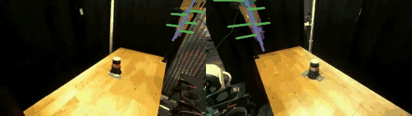
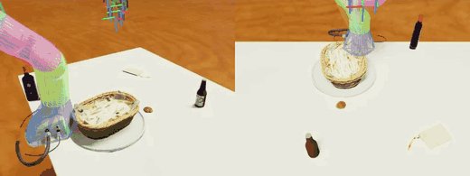
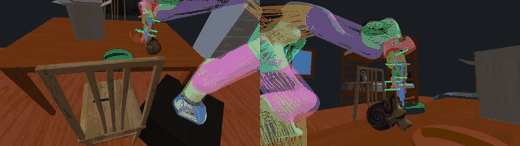
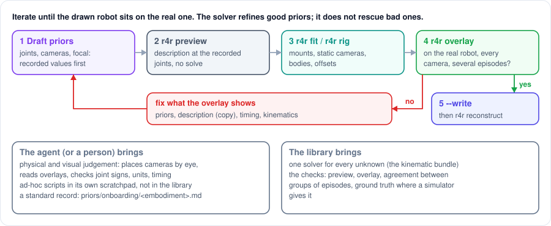
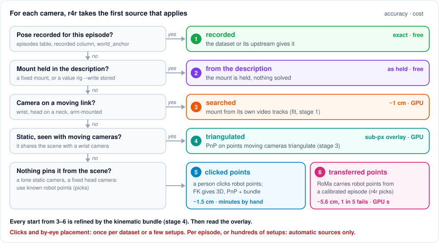
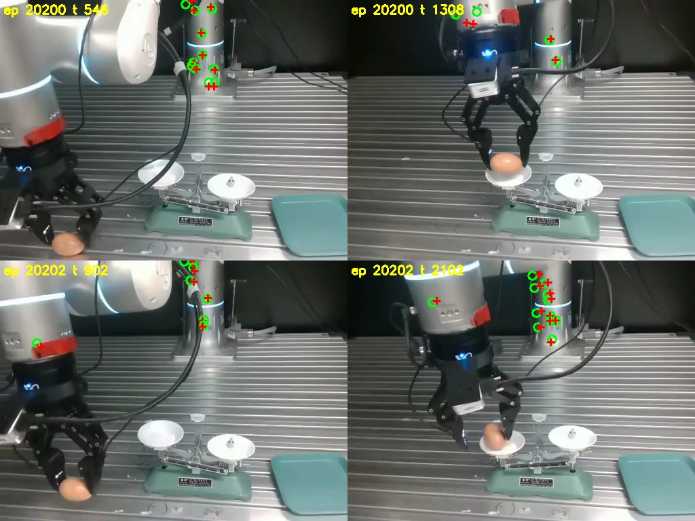
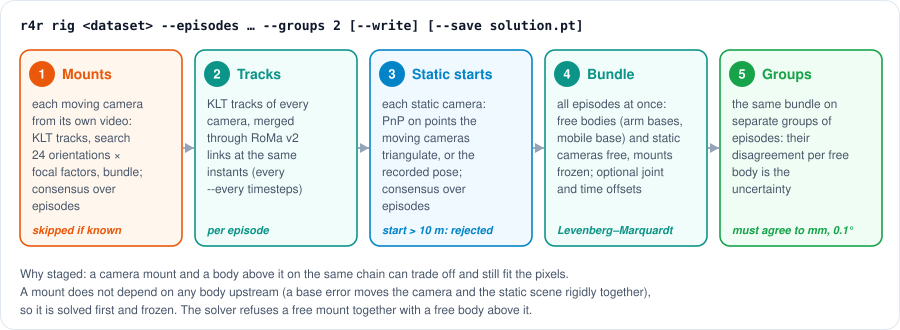
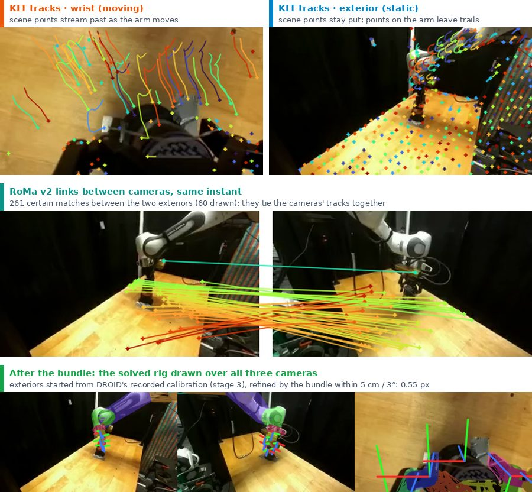
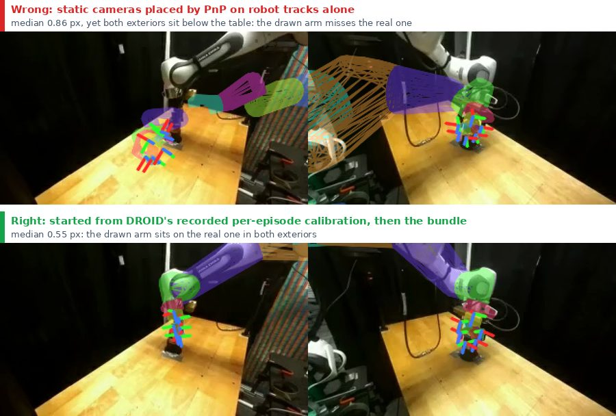

# r4r: robot 4D reconstruction

r4r calibrates robot datasets in the LeRobot format (robot description + joint states +
videos). For every frame it outputs **camera poses, intrinsics and distortion in the robot
base frame, in metres**, end-effector poses, gripper openings and fingertips, the base pose and
the joint state in the description's convention, with corrected kinematics and timing
([output spec](docs/output-spec.md)), merged into a LeRobot dataset. Dense depth and 3D tracks
come later.

<table>
<tr>
<td width="50%"><br><sub><b>DROID</b> (real Panda), two exterior cameras · 0.55 px</sub></td>
<td width="50%"><br><sub><b>InternData-M1</b> (sim Panda + Robotiq) · 0.85 px</sub></td>
</tr>
<tr>
<td><br><sub><b>GR00T sim</b>, Panda on an Omron base · 0.38 px</sub></td>
<td><br><sub><b>MolmoBot</b> (sim, per-episode mounts and focals) · 0.28 px</sub></td>
</tr>
<tr>
<td><br><sub><b>X-VLA soft-fold</b> (real bimanual AgileX) · 1.30 px</sub></td>
<td><br><sub><b>HSR</b> (airoa-moma-5k, mobile base from its record), head camera · 0.62 px</sub></td>
</tr>
<tr>
<td colspan="2"><br><sub><b>SynGrasp-1B</b> (11,292 h, 4.9M episodes): no solve needed, every episode's cameras come from its recorded scene config</sub></td>
</tr>
</table>

<sub>The robot description, drawn with the solved kinematics and cameras over the video
(`r4r overlay`). Numbers are the median reprojection error of each `r4r rig` solve.</sub>

## How it works


- **Inputs:** a LeRobot dataset, its robot description, and a **priors JSON**: what is known
  about the dataset (joint mapping, cameras, focal lengths, ranges).
- **`r4r rig`** fits what the priors leave free, on a sample of episodes, with one solver: a
  kinematic bundle adjustment (camera pose = forward kinematics × mount).
- **Check** with `r4r overlay`, **fix** the priors, **write** them back, then
  **`r4r reconstruct`** every episode.

## Philosophy: an agent in the loop



- A new dataset is onboarded by **an agent (or a person) working iteratively**: optimise,
  check by eye (previews, overlays, simulator ground truth), tune the priors and the
  description, repeat until the drawn robot sits on the real one.
- **The library** provides the solver and the checks. **The agent** brings physical and visual
  judgement and records what it found: `priors/<family>/<dataset>.json` (values) and
  `priors/onboarding/<embodiment>.md` (evidence).

## How each camera gets its pose

Every camera needs a pose in the robot's base frame at every frame. A **moving** camera rides on
a link: pose = FK(joints) · mount, so only its mount is needed. A **static** camera needs its
pose directly. r4r takes the first source that applies:



| # | source | what it is | use when | accuracy | cost |
|---|---|---|---|---|---|
| 1 | **recorded** | given per episode by the dataset or upstream: episodes table, recorded column, or world-frame records via `world_anchor` | always, first | exact | none |
| 2 | **from the description** | the mount is held (description, or a value `rig --write` stored) | fixed, known mount | as held | none |
| 3 | **searched** | moving camera: mount found from its own video tracks (`r4r fit`, rig stage 1) | wrist or head camera | ~0.3–1.3 cm on sims | GPU, once per setup |
| 4 | **triangulated** | static camera: PnP on points the moving cameras triangulate (rig stage 3) | shares the scene with a moving camera | sub-px overlays | GPU, once per setup |
| 5 | **clicked points** | clicked robot points; FK gives 3D; PnP + bundle place the camera (`rig --picks`) | nothing else pins it | ~1.5 cm, 8+ careful clicks (sim ground truth) | minutes by hand |
| 6 | **transferred points** | the same without clicks: RoMa carries robot points from a calibrated episode (`r4r picks`) | many re-placed setups | ~5.6 cm median (SynGrasp), ~20 % fail | ~2 GPU s per camera-episode |

Every start from 3–6 is refined by the kinematic bundle. **Then read the overlay.**

> **Clicks are for calibration, not for scale.** Clicked points and by-eye placement calibrate a
> dataset once, or a handful of setups. Per-episode results, and setups that number in the
> hundreds, must come from automatic sources: recorded values, held calibration, odometry, the
> light solve, transferred points, with the fit check. A dataset whose per-episode cameras need
> clicks is not solved for those cameras.

**Picks file** (`r4r rig --picks picks.json`). A point is a body's origin (named after the
body) or a named offset on a body. Click where the point is, not the surface in front of it: a
joint origin sits on its axis, mid-housing.

```json
{"points": {"jaw_mid": {"body": "panda_hand", "offset": [0, 0, 0.1034]}},
 "picks": [{"episode": 0, "camera": "front", "frame": 42,
            "pixels": {"panda_link0": [312.0, 401.5], "panda_link2": [298.5, 260.0], "jaw_mid": [355.0, 190.5]}}]}
```

`panda_link0` is the base flange, `panda_link2` the shoulder housing, `jaw_mid` the midpoint
between the jaws. Aim for 8+ picks over 4–5 frames, spread over the arm.



<sub><b>Transferred points</b> on a new openneodata Flexiv Rizon 4 session. <b>Green</b>: robot
points RoMa carried from a calibrated episode (the description's surface, ray-cast there, says
which robot point each reference pixel shows). <b>Red</b>: the same points reprojected after the
solve. A start only: read the overlay of every session.</sub>

Details and measurements: [onboarding, cameras the scene cannot pin](docs/dataset-onboarding.md#cameras-the-scene-cannot-pin-robot-keypoints).

## Scopes and setups

Each unknown has a **scope**: how often it may change.

| scope | one value per | example |
|---|---|---|
| dataset | the whole dataset | a wrist mount, a fixed lens |
| station (setup) | a run of episodes with the same placement | a third-person camera between two re-placements |
| episode | episode | a re-placed static camera, a moved arm base |
| frame | frame | a mobile base driving (from its odometry) |

- **`r4r stations <dataset> <camera>`** finds setups from two thumbnails per episode (~30 ms
  each, CPU); `--write` stores them as the `station` column of the episodes table.
- **`r4r station`** then calibrates each new setup's static camera from its calibrated
  neighbour, so hundreds of setups do not each need a full `r4r rig`.

## The stages of `r4r rig`



The same stages on one real DROID episode:



## Install

```bash
uv sync                    # core library and the `r4r` command
uv sync --extra lerobot    # + the LeRobot dataset loader (needed to read datasets)
uv run r4r --help
uv run pytest              # tests
```

Python 3.13. A dataset is named by its root: an absolute path, or a path relative to
`DELIVERY` in `src/r4r/cli.py` (e.g. `droid/datasets/droid`).

## Commands

| command | what it does |
|---|---|
| `inspect` | Print the joint mapping, unmapped columns, joints past their limits, body tree. |
| `sheet` | Show camera frames next to the robot skeleton (PNG). |
| `links` | Tell which body each camera rides on (static or moving). |
| `preview` | Draw the robot with the priors' cameras, no solve (PNG / MP4). |
| `fit` | Find one moving camera's mount and focal; `--shifts` measures the video/state lag. |
| `rig` | Solve the whole rig on a few episodes; `--picks` adds clicked points. |
| `picks` | Transfer robot points from calibrated episodes to new ones (GPU), for `rig --picks`. |
| `stations` | Find setups (runs of episodes with one camera placement) from thumbnails. |
| `station` | Calibrate each new setup's static camera from its neighbour setup. |
| `overlay` | Draw the robot with a saved solution over every camera (PNG / MP4). |
| `export` | Write the description (MJCF) with every known camera and range. |
| `focal` | Draft a focal length with ARROW when none is recorded (GPU). |
| `reconstruct` | Write every episode's per-frame output (sharded parquet); `--plan` costs it first. |
| `merge` | Turn reconstruct shards into a LeRobot v3 dataset (twin or full copy). |

```bash
r4r inspect droid/datasets/droid --episode 0
r4r preview droid/datasets/droid preview.png --episode 150
r4r fit     droid/datasets/droid wrist_left --episodes 0 1 2 --shifts -2 -1 0 1 2
r4r rig     droid/datasets/droid --episodes 150 401 1000 300 --stride 2 --groups 2 --save sol.pt
r4r overlay sol.pt check.png                 # a grid; `episode.mp4 --episode 0` for a video
r4r rig     droid/datasets/droid --episodes 150 401 1000 300 --stride 2 --write  # once it looks right
r4r reconstruct droid/datasets/droid --plan  # routes and CPU / GPU hours, nothing run
r4r stations openneodata/datasets/arx5 third_view --write  # setups from thumbnails (CPU)
r4r merge   syngrasp-1b/datasets/syngrasp-1b out/ dest/  # dest/syngrasp-1b--r4r (LeRobot v3)
```

## Processing every episode: routes

`r4r reconstruct` sends each episode down the cheapest route its unknowns allow.
`--plan` counts the routes and estimates CPU / GPU hours from the priors alone, without running.

| route | when | cost |
|---|---|---|
| fast | every value held or recorded | FK × mount, no video: 13–40 ms CPU per episode |
| light | episode-scope unknowns with a start (re-placed base or static camera), or a flagged fit check | a few bursts of frames: 5–9 s CPU |
| full | the setup was never calibrated, or an unknown has no start | the whole rig: ~0.36 GPU s per second of video |

Fit check, output layout, sharding, timings: [architecture](docs/architecture.md#processing-every-episode-routes-r4r-reconstruct); columns: [output spec](docs/output-spec.md).

## A new dataset, step by step

| step | do | tool |
|---|---|---|
| 1 | Is it in scope? joint states + a description; the loader must run | `r4r inspect` |
| 2 | Fix kinematics: mapping, signs, units, video/state lag | `inspect`, `sheet`, `fit --shifts` |
| 3 | Decide each camera: static or moving, link, focal (recorded first), lens, scope | `links`, `sheet`, dataset metadata |
| 4 | Write the draft priors: `priors/<family>/<dataset>.json` | editor |
| 5 | Place cameras by eye until the drawn robot is close | `r4r preview` (iterate) |
| 6 | Fit moving mounts, then the whole rig on 5–20 episodes | `r4r fit`, `r4r rig --groups 2 --save` |
| 7 | **Check the overlay**: every camera, several episodes | `r4r overlay` |
| 8 | Write the fitted values back; record the evidence | `r4r rig --write`, `priors/onboarding/` |
| 9 | Process every episode | `r4r reconstruct --plan`, then `r4r reconstruct` |

A priors file is a JSON per dataset; a minimal one (DROID) is in the [onboarding guide](docs/dataset-onboarding.md#draft-priors).

**Low residuals are not enough. Look at the overlay.**



Full guide: [`docs/dataset-onboarding.md`](docs/dataset-onboarding.md) (checklist, failure
patterns with images). Field notes: [`docs/field-notes.md`](docs/field-notes.md).

## Repository

| path | content |
|---|---|
| `src/r4r/` | `geometry/` (SE(3), lens models), `data/` (LeRobot loader, priors), `rago/` (tracks, search, bundle, stages), `arrow/` (ARROW reimplementation), `matching/` (RoMa v2), `viz/` (overlay, sheet), `cli.py` |
| `priors/` | one JSON per dataset, corrected descriptions, onboarding records per embodiment, `ISSUES.md` for dataset maintainers |
| `docs/` | [output spec](docs/output-spec.md) · [architecture](docs/architecture.md) · [onboarding](docs/dataset-onboarding.md) · [field notes](docs/field-notes.md) · [related work](docs/related-work.md) |
| `tests/` | mirrors `src/r4r/`: SE(3), lenses, kinematics, bundle and stages on synthetic data, parity with reference releases |
| `experiments/` | measured studies (focal sources, ARROW pose, Kosmo-GFM) with their results |

Built on ARROW ([arXiv:2610.01314](https://arxiv.org/abs/2610.01314), re-implemented) and
Calib3R-style robot-aware calibration ([arXiv:2509.08813](https://arxiv.org/abs/2509.08813)).
Code conventions: [`STYLE.md`](STYLE.md).
