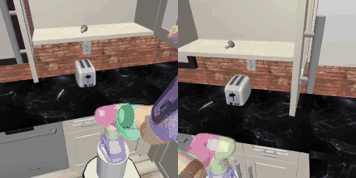
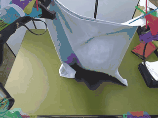
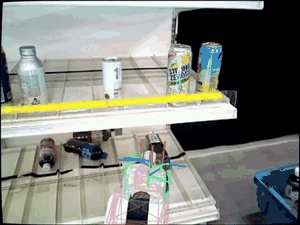
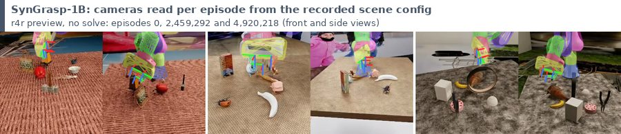
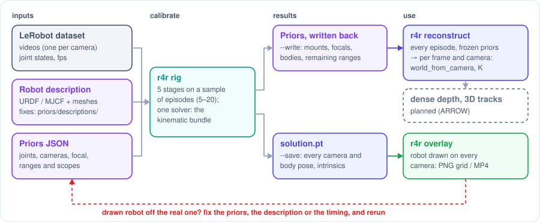

# r4r: robot 4D reconstruction

r4r calibrates robot datasets in the LeRobot format (robot description + joint states +
videos). For every frame it outputs **camera poses and intrinsics in the robot base frame, in
metres**, plus corrected kinematics and timing. Dense depth and 3D tracks come later.

<table>
<tr>
<td width="50%"><br><sub><b>DROID</b> (real Panda), two exterior cameras · 0.55 px</sub></td>
<td width="50%"><br><sub><b>InternData-M1</b> (sim Panda + Robotiq) · 0.85 px</sub></td>
</tr>
<tr>
<td><br><sub><b>GR00T sim</b>, Panda on an Omron base · 0.38 px</sub></td>
<td><br><sub><b>MolmoBot</b> (sim, per-episode mounts and focals) · 0.28 px</sub></td>
</tr>
<tr>
<td><br><sub><b>X-VLA soft-fold</b> (real bimanual AgileX) · 1.30 px</sub></td>
<td><br><sub><b>HSR</b> (airoa-moma-5k, mobile base from its record), head camera · 0.62 px</sub></td>
</tr>
<tr>
<td colspan="2"><br><sub><b>SynGrasp-1B</b> (11,292 h, 4.9M episodes): no solve needed, every episode's cameras come from its recorded scene config</sub></td>
</tr>
</table>

<sub>The robot description, drawn with the solved kinematics and cameras over the video
(`r4r overlay`). Numbers are the median reprojection error of each `r4r rig` solve.</sub>

## How it works



- **Inputs:** a LeRobot dataset, its robot description, and a **priors JSON** that holds what
  is known about the dataset (joint mapping, cameras, focal lengths, ranges).
- **`r4r rig`** fits whatever the priors leave free, on a sample of episodes, with one solver:
  a kinematic bundle adjustment (camera pose = forward kinematics × mount).
- **Check** with `r4r overlay`; **fix** the priors; **write** them back; **`r4r reconstruct`**
  every episode.

## Philosophy: an agent in the loop


- r4r is meant to be used on a new dataset by **an agent (or a person) working iteratively**:
  optimise, check by eye (previews, overlays, ground truth when a simulator gives it), tune
  the priors and the description, repeat until the drawn robot sits on the real one.
- **The library** provides the solver and the checks.
- **The agent** brings physical and visual judgement. It keeps its ad-hoc scripts in its own
  scratchpad and records what it found in a standard format:
  `priors/<family>/<dataset>.json` (values) and `priors/onboarding/<embodiment>.md` (evidence).

## Install

```bash
uv sync                    # core library and the `r4r` command
uv sync --extra lerobot    # + the LeRobot dataset loader (needed to read datasets)
uv run r4r --help
uv run pytest              # tests
```

Python 3.13. A dataset is named by its root: an absolute path, or a path relative to
`DELIVERY` in `src/r4r/cli.py` (e.g. `droid/datasets/droid`).

## Commands

| command | what it does | output |
|---|---|---|
| `inspect` | joint mapping, unmapped varying columns, joints past their limits, body tree | text |
| `sheet` | camera frames next to the robot skeleton | PNG |
| `links` | motion evidence for the body each camera rides on (static or moving) | text |
| `preview` | the description drawn at the recorded joints, cameras from the priors, **no solve** | PNG / MP4 |
| `fit` | one moving camera: its body, mount and focal; `--shifts` measures the video/state lag | text, `--write` |
| `rig` | the whole rig in 5 stages (below), checked by groups of episodes | text, `--write`, `--save` |
| `overlay` | the robot drawn with a saved solution over every camera | PNG / MP4 |
| `export` | the description (MJCF) with every known camera placed and each range | XML |
| `focal` | a focal-length draft from ARROW (gen2 adapter) when nothing is recorded; GPU | text |
| `reconstruct` | every episode with frozen priors: poses and intrinsics per frame | parquet |

```bash
r4r inspect droid/datasets/droid --episode 0
r4r preview droid/datasets/droid preview.png --episode 150
r4r fit     droid/datasets/droid wrist_left --episodes 0 1 2 --shifts -2 -1 0 1 2
r4r rig     droid/datasets/droid --episodes 150 401 1000 300 --stride 2 --groups 2 --save sol.pt
r4r overlay sol.pt check.png                 # a grid: a few moments of every episode
r4r overlay sol.pt episode.mp4 --episode 0   # a video of one solved episode
r4r rig     droid/datasets/droid --episodes 150 401 1000 300 --stride 2 --write  # once it looks right
r4r reconstruct droid/datasets/droid out/ --episodes 0 1 2
```

`reconstruct` writes `out/<family>/<dataset>/episode_<n>.parquet`: one row per frame and
camera with `world_from_camera` (4×4 row-major, robot base frame, OpenCV axes), `fx, fy, cx, cy`,
and the episode's median reprojection error and inlier share.

## The stages of `r4r rig`


The same stages on one real DROID episode:


## Frames


- **Moving camera:** rigid on a link. Pose = FK(joint states) · mount; the mount is fitted once.
- **Static camera:** a pose in the base frame, per dataset or per episode.
- **Free bodies:** a second arm's base, a mobile base (per frame, started from its odometry).

## A new dataset, step by step

| step | do | tool |
|---|---|---|
| 1 | Is it in scope? joint states + a description; the loader must run | `r4r inspect` |
| 2 | Fix kinematics: mapping, signs, units, video/state lag | `inspect`, `sheet`, `fit --shifts` |
| 3 | Decide each camera: static or moving, link, focal (recorded first), lens, scope | `links`, `sheet`, dataset metadata |
| 4 | Write the draft priors: `priors/<family>/<dataset>.json` | editor |
| 5 | Place cameras by eye until the drawn robot is close | `r4r preview` (iterate) |
| 6 | Fit moving mounts, then the whole rig on 5–20 episodes | `r4r fit`, `r4r rig --groups 2 --save` |
| 7 | **Check the overlay**: every camera, several episodes | `r4r overlay` |
| 8 | Write the fitted values back; record the evidence | `r4r rig --write`, `priors/onboarding/` |
| 9 | Process every episode | `r4r reconstruct` |

A minimal priors file (trimmed from `priors/droid/droid.json`):

```json
{
  "description": "descriptions/franka__panda/panda_robotiq.urdf",
  "joints": [{"index": 7, "urdf_joint": "gripper_finger_joint", "from": [0, 1], "to": [0, 0.725]}],
  "cameras": {
    "wrist_left": {"mount": "moving", "link": "panda_link8",
                   "position": [-0.0769, 0.0326, 0.0181], "orientation": [0.6963, -0.1177, 0.1221, -0.6965],
                   "position_range": 0.03, "orientation_range_deg": 5.0, "focal": 183.0, "focal_range": 0.01},
    "exterior_1_left": {"mount": "static", "scope": "episode", "focal": 131.0, "focal_range": 0.02,
                        "position_range": 0.05, "orientation_range_deg": 3.0}
  }
}
```

**Low residuals are not enough. Look at the overlay.**


Full guide: [`docs/dataset-onboarding.md`](docs/dataset-onboarding.md) (checklist, failure
patterns with images). Field notes: [`docs/field-notes.md`](docs/field-notes.md).

## Repository

| path | content |
|---|---|
| `src/r4r/` | `geometry/` (SE(3), lens models), `data/` (LeRobot loader, priors), `rago/` (tracks, search, bundle, stages), `arrow/` (ARROW reimplementation), `matching/` (RoMa v2), `viz/` (overlay, sheet), `cli.py` |
| `priors/` | one JSON per dataset, corrected descriptions, onboarding records per embodiment, `ISSUES.md` for dataset maintainers |
| `docs/` | [architecture](docs/architecture.md) · [onboarding](docs/dataset-onboarding.md) · [field notes](docs/field-notes.md) · [related work](docs/related-work.md) |
| `tests/` | mirrors `src/r4r/`: SE(3), lenses, kinematics, bundle and stages on synthetic data, parity with reference releases |
| `experiments/` | measured studies (focal sources, ARROW pose, Kosmo-GFM) with their results |

Built on ARROW ([arXiv:2610.01314](https://arxiv.org/abs/2610.01314), re-implemented) and
Calib3R-style robot-aware calibration ([arXiv:2509.08813](https://arxiv.org/abs/2509.08813)).
Code conventions: [`STYLE.md`](STYLE.md).
