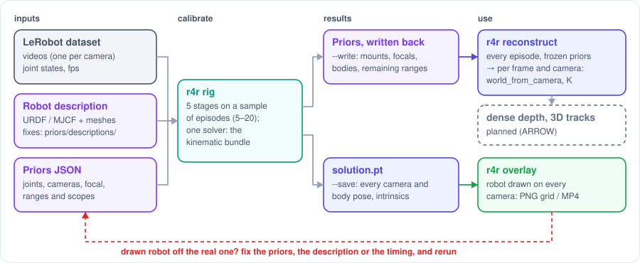
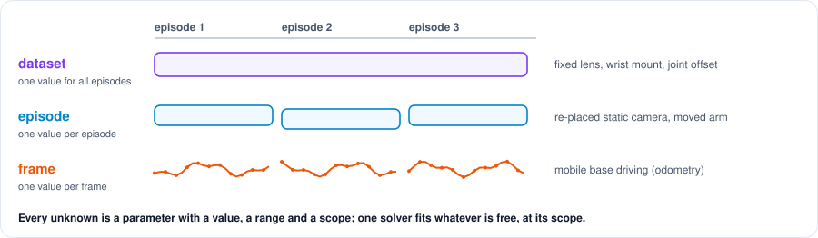
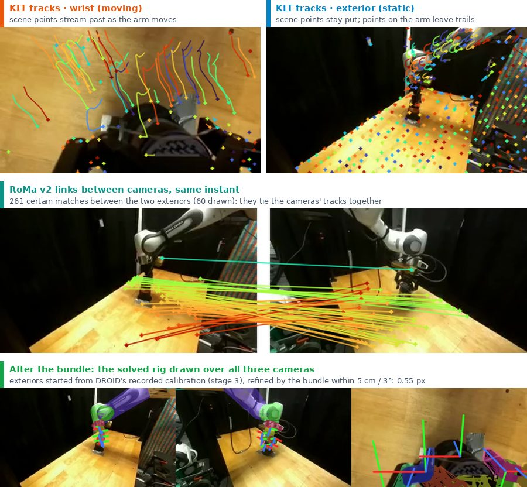

# How r4r works

r4r turns a robot dataset (videos, joint states, robot description) into camera poses and
intrinsics for every frame, in the robot's base frame and in metres, and later into dense
depth, 3D tracks and point clouds that line up with the robot model.

Legend: ✅ exists and is tested on several datasets · 🔶 prototype in `research/` · ⬜ planned.

## One idea: every unknown is a parameter with a value, a range and a scope

Nothing about a dataset is hard-coded in the library. Everything a dataset can get wrong or
leave out is a parameter of the robot description, with a **value** (best known so far), a
**range** (how far fitting may move it) and a **scope** (how often it may change).

| unknown | typical scope | status |
|---|---|---|
| joint mapping, signs, units, video/state offset | dataset | ✅ priors (`joints`, `state_shift`); units in the loader |
| joint-encoder and sub-frame time offsets | dataset | ✅ `kinematics` in the priors, refined in every `r4r rig` bundle |
| focal length | dataset (episode for randomising sims) | ✅ prior + fit; ✅ `r4r focal` draft (optional) |
| moving-camera mount (link, pose) | dataset (episode when recorded per episode) | ✅ search + bundle + episode consensus |
| static-camera pose | dataset or episode | ✅ PnP on moving-camera points or robot keypoints, or a recorded pose, + bundle |
| arm-base placement (bimanual) | dataset or episode | ✅ free bodies, written back to the priors |
| robot base pose | frame | ✅ free body per frame, started from recorded odometry (`base_odometry`); ⬜ legged odometry for humanoids |
| lens distortion | dataset | ✅ prior + bundle refinement; ⬜ AnyCalib initialiser |

- Values and ranges live in `priors/<family>/<dataset>.json`.
- `r4r export` writes them into the description (MJCF): every camera placed, every range as an
  `r4r:` numeric, so the description itself says what is known and what still varies.
- One solver (the kinematic bundle) fits whatever is free, at its scope.

## Frames

| thing | pose | how it is known |
|---|---|---|
| link | `base_from_link = FK(qₜ)` | the joint states, through the description |
| moving camera | `FK(qₜ) · mount` | mount fitted once (or recorded per episode) |
| static camera | `base_from_camera` | PnP or a recorded pose, then the bundle |
| free body | correction on its parent's offset | the bundle; a mobile base per frame from odometry |

Conventions (`STYLE.md`): transforms are `a_from_b`, cameras use OpenCV axes (x right, y down,
z forward), units are metres and radians.

## `r4r rig`: solving coupled unknowns in stages

Two unknowns on the same chain can trade off: a wrist camera's mount and its arm's base, or a
static camera and a free body, can absorb each other's error and still fit the pixels. The
solver refuses a free mount together with a free body above it; `r4r rig` solves in stages
(`src/r4r/rago/stages.py`).

| stage | input | output | tools |
|---|---|---|---|
| 1 mounts | each moving camera's own video | its mount (and focal, distortion), frozen | KLT, batched search, bundle, consensus |
| 2 tracks | every camera, per episode | multi-camera tracks | KLT + RoMa v2 links every `--every` timesteps |
| 3 static starts | points triangulated by the moving cameras; picked robot points | each static camera's start, per episode | PnP or recorded pose; consensus; > 10 m rejected |
| 4 bundle | all episodes | free bodies, static cameras, offsets | kinematic bundle (LM) |
| 5 groups | separate groups of episodes | disagreement per free body | the same bundle per group |

Robot keypoints (`rago/keypoints.py`) place cameras the scene cannot: a static camera with no
moving camera to triangulate for it, a head camera that never moves relative to the base, a
wrist that sees the other arm but not its own gripper. A keypoint is a pixel clicked on a
known robot point (`r4r rig --picks`), whose 3D position is FK of the point:

- start: PnP on the picks, in the frame of the body the camera rides on (stage 1 for a moving
  camera, pooled over episodes, instead of the search; stage 3 for a static one);
- refinement: a reprojection residual in the bundles, next to the tracks; a moving mount with
  keypoints stays free within its priors' ranges.

A rig with no moving camera attaches no track to a link: seen from fixed centres only, such
tracks pulled good starts 10–80 cm away (SynGrasp, Tien Kung). Pixels found automatically (KLT
following picks, seeds where a start projects the points) were tried against SynGrasp's
recorded cameras and dropped: no gain, or worse starts (`keypoints.py`, module doc). What
works without clicks is `r4r picks` (`rago/transfer.py`): robot surface points of a calibrated
session (the description ray-cast in its frames) carried to another session by RoMa v2, at about
3× the error of clicks ([onboarding](dataset-onboarding.md)). The geometry only names the point
a reference pixel shows; the solve sees keypoints, never meshes.

On a mobile base, stage 1 uses each episode's longest span where the record says the base is
parked (≥ 20 timesteps), stage 3 places static cameras with the base moved, and the bundle
starts the per-frame base from the record.

## The solver: kinematic bundle adjustment

- **Camera poses are hard constraints:** every view is `world_from_body(qₜ) · mount`, metric by
  construction. Scale comes from the robot's motion.
- **Variable projection:** each track's 3D point is triangulated in closed form inside the
  residual (weighted least squares on its rays). No point unknowns: θ stays a few dozen numbers.
- **Moving tracks:** a point on the robot (or a grasped object) is triangulated in the frame of
  the link that explains it best, re-decided between rounds. The moving robot then becomes a
  calibration target that pins far static cameras. Tracks no link explains are dropped.
- **Robust loss:** Cauchy, `ρ(s) = log(1 + s)`, `s = |r|²/δ²`, δ ≈ 2–3 px (0.01 × focal).
- **Levenberg–Marquardt** (`rago/solver.py`): IRLS weights, `(H + λ diag H) Δ = −g`, a step is
  accepted only if the robust objective decreases. Tens of steps replace Adam's ~1000. The
  Jacobian is compressed: an observation depends on one row of each scoped unknown.
- **Adam** remains for frame-scope rows (a mobile base per frame) and for the mount search,
  where many independent starts are solved at once.
- **Priors:** each unknown has a Gaussian prior from its value and range in the priors JSON.

### Mount search (stage 1, `r4r fit`)

The bundle converges from ~25 cm / 10° away, not from anywhere. Short bundles start from the 24
axis-aligned orientations of the camera on its link × a few focal factors (0.2–1.5 × the
guess), in one batched solve on a subsample of the camera's tracks; the best score wins.
Per-episode results are pooled: the consensus mount, then one bundle over agreeing episodes.

## Lens models

Every camera is radially symmetric (`r4r.geometry.camera`): a ray at `s` from the axis lands at
`d(s) = s · (1 + k1 s² + k2 s⁴ + k3 s⁶ + k4 s⁸)`, then `pixel = f · d + c`.

| lens | `s` | coefficients | all zero means |
|---|---|---|---|
| `pinhole` | `r / z` | OpenCV radial `k1, k2, k3` (no tangential) | ideal pinhole |
| `fisheye` | angle θ from the axis | Kannala–Brandt, OpenCV fisheye `k1..k4` | equidistant, valid past 90° |

- These are what datasets and drivers publish (OpenCV `distCoeffs`, `cv2.fisheye`, ROS
  `equidistant`, RealSense `kannala_brandt4`) and what AnyCalib outputs.
- One batched Newton iteration inverts both (`camera.rays`).
- Coefficients are a dataset-scope prior per camera (`lens`, `distortion`, `distortion_range`),
  refined additively by the bundle with a Gaussian prior. They do not depend on the video
  resolution.
- Measured (`tests/rago/test_lens.py`): a ~150° wrist fisheye recovered to 0.4 px up to 77°
  off-axis, with mount and focal.
- A static camera that sees the scene in a narrow cone leaves its coefficients near the prior,
  its focal trading with its distance. Give a static fisheye its focal, or hold its lens.

## From a dataset to every episode

| phase | goal | how | status |
|---|---|---|---|
| 1 preparation (once per dataset) | priors good enough to run unattended | the agent: `inspect`, `sheet`, `links`, `preview`, `fit --shifts`, focal from records ([onboarding](dataset-onboarding.md)) | ✅ |
| 2 setup calibration (once per setup) | dataset-scope values, ranges of episode-scope ones | `r4r rig` on 5–20 episodes; consensus; groups; `--write` | ✅ (⬜ window selection, held-out report) |
| 3 per-episode processing | poses for every frame of every episode | `r4r reconstruct`, by route (`r4r.plan`): fast (every calibrated value held: FK × mount, no video read), light (episode-scope unknowns on 6 bursts of frames, CPU: `rago/light.py`), full (setup never calibrated: the whole rig). Fit check on real episodes; `--plan` for the cost; `r4r stations` for setups. Sharded output (`--shard-size`) in the [output spec](output-spec.md)'s columns, resumable, `--shard i/n` per process; `r4r merge` into a LeRobot v3 twin or full copy | ✅ |
| 4 dense reconstruction | depth for every pixel, 3D tracks, fused point cloud | ARROW per encoding, aligned to our cameras (one scale and pose per encoding) | ⬜ |

- Stage 3 at scale: once a dataset's setups are calibrated, nearly every episode is fast
  (milliseconds, no video) and the rest light (seconds of CPU); GPU only calibrates setups.
  A mobile base is held on its record with a dataset-level `base_odometry.correction`
  (`OdometryGain`: wheel scale, heading gain, yaw-rate bias), fitted once by `r4r rig --write`
  against the bundle's free base.
- Stage 4 compute, measured on one episode: ~15–20 GPU-minutes at depth stride 2
  (1–1.5 GPU-h at stride 1), i.e. 10–20 GPU-h per hour of video. Options: keyframes, lower
  resolution, or a lighter per-frame depth model scaled with our sparse points.
- ARROW cannot take our camera poses as input (pose conditioning copied the draft instead of
  correcting it): the cameras stay ours, ARROW supplies the dense shape.
- Static cameras' focal is weakly constrained by one episode (focal ↔ distance): it comes from
  preparation and is shared across episodes.

## Processing every episode: routes (`r4r reconstruct`)

Each episode takes the cheapest route its unknowns allow (`r4r.plan`). Values of dataset or
station scope are held once `r4r rig --write` wrote them (or recorded); only episode-scope ones
stay free.

| route | when | how | cost (measured on a login node) |
|---|---|---|---|
| fast | everything held or recorded (a moving base on its odometry with a fitted `base_odometry.correction`, or a recorded pose) | forward kinematics × mount, no video read | 13 ms per SynGrasp episode (1,000 in 13 s); 13–40 ms in general; 0.32 s per sim-panda episode sampled across 460k (one data file each) |
| light | episode-scope 6-DoF unknowns with a start (a re-placed robot base, a re-placed static camera), or a real episode the fit check flags | 6 bursts of 16 frames decoded alone, KLT + SIFT links, LM on those unknowns only (`rago/light.py`) | 5–9 s CPU; 41–57 s per episode under load |
| full | its setup was never calibrated, or an unknown has no start | the whole rig on the episode | ~0.36 GPU s per second of video |

- **Fit check:** real episodes holding a recorded episode-scope camera (DROID's per-episode
  calibration) are checked on the bursts: the epipolar distance of verified matches between
  the held cameras; above 25 px the record is freed and solved light (`--check on/off/auto`).
- **`--plan`:** counts the routes over a dataset from its priors and episodes table alone (no
  episode loaded) and estimates CPU and GPU hours, calibrating each uncalibrated setup once
  included.
- **`--solve`** solves every episode in full. **`--uncalibrated nan`** writes a camera its setup
  never calibrated as NaN instead of running the full route.
- **`r4r stations`:** runs of episodes with one placement of a camera that is not on the robot,
  from two thumbnails per episode (~30 ms per episode); `--write` stores them as the `station`
  column of the episodes table. **`r4r station`** then calibrates each new station's static
  camera from its calibrated neighbour (`rago/station.py`: neighbour's pose, PnP on wrist
  triangulations, transferred robot points, in that order, each checked), mostly on the CPU.
- **Per-camera setups:** static cameras re-placed independently of each other (robomind2
  dual-franka: side cameras moved between tasks, front and top on the rig) each get their own
  key, the column `station.<camera>` (`r4r stations --per-camera --write`). That camera's values
  come from its own `stations.<key>` block (only its entry), on top of the common `station`'s;
  `r4r station` and the planner use the camera's key when the column exists, and `r4r rig`
  refuses episodes of several keys of one camera.
- **`r4r silhouette`** (`rago/silhouette.py`): a static camera re-placed per setup that scene
  matches, neighbour seeds and transferred points cannot place, fitted to the robot's
  silhouette. The one place robot meshes enter a solve (user decision, 2026-11-16). Details below.
- **Output layout:** `out/<family>/<dataset>/shard-<k>.parquet`, one file per `--shard-size`
  episodes (default 1000) of the selection, one row per frame in the
  [output spec](output-spec.md)'s columns. The schema metadata `r4r.episodes` (JSON) gives per
  episode its route, fit check, each camera's source and errors, or the error that stopped it;
  `r4r.layout` holds the feature info.
- **Resumable:** a shard is written once, atomically; shards already written are skipped.
- **Spread over processes:** `--shard i/n` takes the shards `k` with `k mod n = i`, e.g. a
  Slurm array: `--shard $SLURM_ARRAY_TASK_ID/$SLURM_ARRAY_TASK_COUNT`.
- **Merge:** `r4r merge` writes the shards as a LeRobot v3 dataset with `meta/r4r.json`
  (quality and provenance), ~12 s per 1,000 SynGrasp episodes
  ([packaging](output-spec.md#packaging-r4r-merge)).

### Per-setup static cameras from the robot's silhouette (`r4r silhouette`)

Some static cameras move between setups (source repos, stations, sessions). For them, scene
matches with the wrist cameras (rigs, light route) land 2-24 cm off at small residuals,
neighbour seeds pass 1 time in 8, and transferred points are ~5.6 cm off. Every setup shows
the robot, though, and its joints are recorded: the camera is where the description's
projected surface covers the robot in the image.

1. **Frames.** Per setup, `--samples` episodes fit and `--held` other episodes score. Per
   episode, `kept` (3) of 40 evenly spaced frames, spread in joint space.
2. **Masks.** SAM 3 with the text prompt "robot arm" (`python -m r4r.rago.segment`, GPU,
   ~1.3 s per setup for 18 frames, in its own environment). Background subtraction (the
   median of the episode's frames, CIELAB distance, exposure normalised) is the fallback
   when no masks are given. It works only where the robot is the one thing that moves.
3. **Model.** 150 area-weighted points per body on the drawn surfaces (`viz.overlay.surfaces`),
   posed by forward kinematics with the priors' kinematics corrections.
4. **Loss** `ρ(r) = r²/(1+r²)`, `r = d/σ` (bounded, so clutter and occlusion cost at most 1):
   each point to the mask (distance transform), and each mask pixel to the nearest projected
   point (×0.5); fingers ×0.3. A weak Gaussian prior on the departure from the seed (0.3 m,
   20°) keeps a bimanual robot with one arm in view from fitting the other arm.
5. **Fit.** Adam, from each seed (the setup's priors, calibrated setups) and 10 perturbations,
   σ 40 → 20 px on all of them, then 10 → 5 px on the best 3. The pose moves about a pivot
   at the robot's depth, which keeps rotation and translation nearly independent. CPU: 10-50 s
   per setup.
6. **Score** on the held-out frames: the IoU of the drawn robot with the mask (`iou`) and the
   share of model points inside it (`precision`). Below `pass_iou` or `pass_precision`, the
   setup is flagged and written as a start only (orientation range 180°). The planner then
   counts it as uncalibrated, and `--uncalibrated nan` leaves it NaN.

Results are in [verification](verification.md#per-setup-static-cameras-from-silhouettes-2026-11-16).

## Which tool is used where

| tool | used for | on what |
|---|---|---|
| KLT (OpenCV) | per-camera tracks | every frame of the sampled episodes (CPU, ~2 s per camera per minute of video) |
| batched search + bundle | mounts, focal, any free parameter | tracks of sampled windows; batched copies |
| RoMa v2 (`r4r.matching`) | static↔moving and static↔static links; robot keypoints from calibrated sessions (`r4r picks`) | a few dozen frame pairs per episode, kept where it is certain |
| ARROW | focal draft (`r4r focal`, gen2 adapter); dense depth and tracks (planned) | sampled frames; all frames (dense pass) |
| robot meshes | overlays; which surface point a reference pixel shows (`r4r picks`); inside a solve only for per-setup static cameras (`r4r silhouette`) | `r4r preview`, `r4r overlay`, `r4r picks`, `r4r silhouette` |
| SAM 3 (`r4r.rago.segment`, own environment) | robot masks for `r4r silhouette` | 18 frames per setup (GPU) |

Bad frames (zoomed-in wrist, no texture, dark, motion blur) are not detected by rules on the
image: they show up as few surviving KLT tracks, low RoMa certainty, high residuals or
disagreement with the other episodes, and are left out by consensus.

## Output

Per frame, in the episode frame (the base at the episode's first frame): camera poses,
intrinsics and distortion; per arm the `ee` frame (TCP or palm, shared axis meaning), gripper
opening, aperture and fingertips (`r4r.effectors`, presets per gripper and hand); the base pose;
the joint state in the description's convention. The whole contract, its side file and
packaging: [output-spec.md](output-spec.md).

The cluster setup (environments, caches, job helpers) lives in `jupiter/`.
