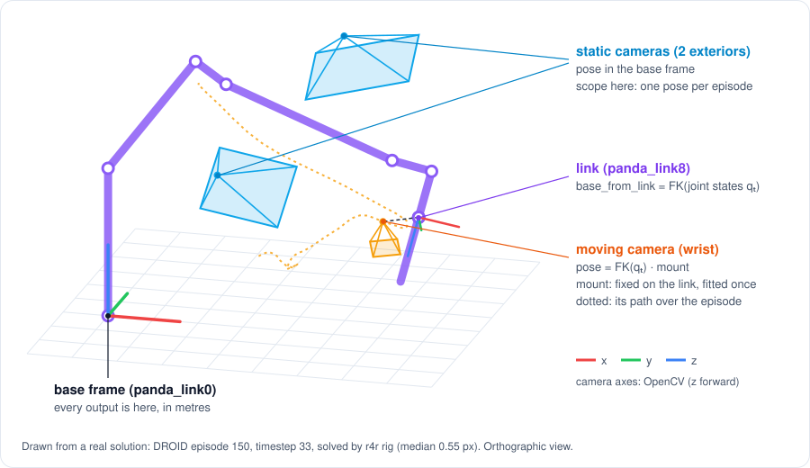
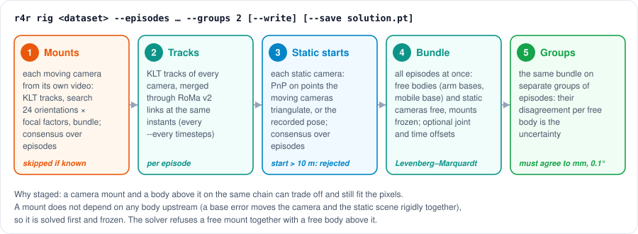
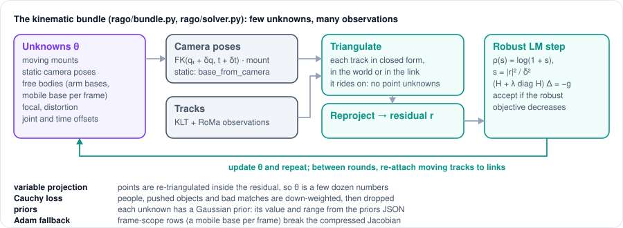

# How r4r works

r4r turns a robot dataset (videos, joint states, robot description) into camera poses and
intrinsics for every frame, in the robot's base frame and in metres, and later into dense
depth, 3D tracks and point clouds that line up with the robot model.

Legend: ✅ exists and is tested on several datasets · 🔶 prototype in `research/` · ⬜ planned.

## One idea: every unknown is a parameter with a value, a range and a scope

Nothing about a dataset is hard-coded in the library. Everything a dataset can get wrong or
leave out is a parameter of the robot description, with a **value** (best known so far), a
**range** (how far fitting may move it) and a **scope** (how often it may change).

| unknown | typical scope | status |
|---|---|---|
| joint mapping, signs, units, video/state offset | dataset | ✅ priors (`joints`, `state_shift`); units in the loader |
| joint-encoder and sub-frame time offsets | dataset | ✅ `kinematics` in the priors, refined in every `r4r rig` bundle |
| focal length | dataset (episode for randomising sims) | ✅ prior + fit; ✅ `r4r focal` draft (optional) |
| moving-camera mount (link, pose) | dataset (episode when recorded per episode) | ✅ search + bundle + episode consensus |
| static-camera pose | dataset or episode | ✅ PnP on moving-camera points or robot keypoints, or a recorded pose, + bundle |
| arm-base placement (bimanual) | dataset or episode | ✅ free bodies, written back to the priors |
| robot base pose | frame | ✅ free body per frame, started from recorded odometry (`base_odometry`); ⬜ legged odometry for humanoids |
| lens distortion | dataset | ✅ prior + bundle refinement; ⬜ AnyCalib initialiser |

- Values and ranges live in `priors/<family>/<dataset>.json`.
- `r4r export` writes them into the description (MJCF): every camera placed, every range as an
  `r4r:` numeric, so the description itself says what is known and what still varies.
- One solver (the kinematic bundle) fits whatever is free, at its scope.

## Frames

| thing | pose | how it is known |
|---|---|---|
| link | `base_from_link = FK(qₜ)` | the joint states, through the description |
| moving camera | `FK(qₜ) · mount` | mount fitted once (or recorded per episode) |
| static camera | `base_from_camera` | PnP or a recorded pose, then the bundle |
| free body | correction on its parent's offset | the bundle; a mobile base per frame from odometry |

Conventions (`STYLE.md`): transforms are `a_from_b`, cameras use OpenCV axes (x right, y down,
z forward), units are metres and radians.

## `r4r rig`: solving coupled unknowns in stages

Two unknowns on the same chain can trade off: a wrist camera's mount and its arm's base, or a
static camera and a free body, can absorb each other's error and still fit the pixels. The
solver refuses a free mount together with a free body above it; `r4r rig` solves in stages
(`src/r4r/rago/stages.py`).

| stage | input | output | tools |
|---|---|---|---|
| 1 mounts | each moving camera's own video | its mount (and focal, distortion), frozen | KLT, batched search, bundle, consensus |
| 2 tracks | every camera, per episode | multi-camera tracks | KLT + RoMa v2 links every `--every` timesteps |
| 3 static starts | points triangulated by the moving cameras; picked robot points | each static camera's start, per episode | PnP or recorded pose; consensus; > 10 m rejected |
| 4 bundle | all episodes | free bodies, static cameras, offsets | kinematic bundle (LM) |
| 5 groups | separate groups of episodes | disagreement per free body | the same bundle per group |

Robot keypoints (`rago/keypoints.py`) place cameras the scene cannot: a static camera with no
moving camera to triangulate for it, a head camera that never moves relative to the base, a
wrist that sees the other arm but not its own gripper. A keypoint is a pixel clicked on a
known robot point (`r4r rig --picks`), whose 3D position is FK of the point:

- start: PnP on the picks, in the frame of the body the camera rides on (stage 1 for a moving
  camera, pooled over episodes, instead of the search; stage 3 for a static one);
- refinement: a reprojection residual in the bundles, next to the tracks; a moving mount with
  keypoints stays free within its priors' ranges.

A rig with no moving camera attaches no track to a link: seen from fixed centres only, such
tracks pulled good starts 10–80 cm away (SynGrasp, Tien Kung). Pixels found automatically (KLT
following picks, seeds where a start projects the points) were tried against SynGrasp's
recorded cameras and dropped: no gain, or worse starts (`keypoints.py`, module doc).

On a mobile base, stage 1 uses each episode's longest span where the record says the base is
parked (≥ 20 timesteps), stage 3 places static cameras with the base moved, and the bundle
starts the per-frame base from the record.

## The solver: kinematic bundle adjustment

- **Camera poses are hard constraints:** every view is `world_from_body(qₜ) · mount`, metric by
  construction. Scale comes from the robot's motion.
- **Variable projection:** each track's 3D point is triangulated in closed form inside the
  residual (weighted least squares on its rays). No point unknowns: θ stays a few dozen numbers.
- **Moving tracks:** a point on the robot (or a grasped object) is triangulated in the frame of
  the link that explains it best, re-decided between rounds. The moving robot then becomes a
  calibration target that pins far static cameras. Tracks no link explains are dropped.
- **Robust loss:** Cauchy, `ρ(s) = log(1 + s)`, `s = |r|²/δ²`, δ ≈ 2–3 px (0.01 × focal).
- **Levenberg–Marquardt** (`rago/solver.py`): IRLS weights, `(H + λ diag H) Δ = −g`, a step is
  accepted only if the robust objective decreases. Tens of steps replace Adam's ~1000. The
  Jacobian is compressed: an observation depends on one row of each scoped unknown.
- **Adam** remains for frame-scope rows (a mobile base per frame) and for the mount search,
  where many independent starts are solved at once.
- **Priors:** each unknown has a Gaussian prior from its value and range in the priors JSON.

### Mount search (stage 1, `r4r fit`)

The bundle converges from ~25 cm / 10° away, not from anywhere. Short bundles start from the 24
axis-aligned orientations of the camera on its link × a few focal factors (0.2–1.5 × the
guess), in one batched solve on a subsample of the camera's tracks; the best score wins.
Per-episode results are pooled: the consensus mount, then one bundle over agreeing episodes.

## Lens models

Every camera is radially symmetric (`r4r.geometry.camera`): a ray at `s` from the axis lands at
`d(s) = s · (1 + k1 s² + k2 s⁴ + k3 s⁶ + k4 s⁸)`, then `pixel = f · d + c`.

| lens | `s` | coefficients | all zero means |
|---|---|---|---|
| `pinhole` | `r / z` | OpenCV radial `k1, k2, k3` (no tangential) | ideal pinhole |
| `fisheye` | angle θ from the axis | Kannala–Brandt, OpenCV fisheye `k1..k4` | equidistant, valid past 90° |

- These are what datasets and drivers publish (OpenCV `distCoeffs`, `cv2.fisheye`, ROS
  `equidistant`, RealSense `kannala_brandt4`) and what AnyCalib outputs.
- One batched Newton iteration inverts both (`camera.rays`).
- Coefficients are a dataset-scope prior per camera (`lens`, `distortion`, `distortion_range`),
  refined additively by the bundle with a Gaussian prior. They do not depend on the video
  resolution.
- Measured (`tests/rago/test_lens.py`): a ~150° wrist fisheye recovered to 0.4 px up to 77°
  off-axis, with mount and focal.
- A static camera that sees the scene in a narrow cone leaves its coefficients near the prior,
  its focal trading with its distance. Give a static fisheye its focal, or hold its lens.

## From a dataset to every episode

| phase | goal | how | status |
|---|---|---|---|
| 1 preparation (once per dataset) | priors good enough to run unattended | the agent: `inspect`, `sheet`, `links`, `preview`, `fit --shifts`, focal from records ([onboarding](dataset-onboarding.md)) | ✅ |
| 2 setup calibration (once per setup) | dataset-scope values, ranges of episode-scope ones | `r4r rig` on 5–20 episodes; consensus; groups; `--write` | ✅ (⬜ window selection, held-out report) |
| 3 per-episode processing | poses for every frame of every episode | `r4r reconstruct`: nothing free (cameras recorded or held, focals known): pose = FK × mount, no video read; else episode/frame-scope unknowns fitted within their ranges. Sharded output (`--shard-size`), resumable, `--shard i/n` per process | ✅ |
| 4 dense reconstruction | depth for every pixel, 3D tracks, fused point cloud | ARROW per encoding, aligned to our cameras (one scale and pose per encoding) | ⬜ |

- Stage 4 compute, measured on one episode: ~15–20 GPU-minutes at depth stride 2
  (1–1.5 GPU-h at stride 1), i.e. 10–20 GPU-h per hour of video. Options: keyframes, lower
  resolution, or a lighter per-frame depth model scaled with our sparse points.
- ARROW cannot take our camera poses as input (pose conditioning copied the draft instead of
  correcting it): the cameras stay ours, ARROW supplies the dense shape.
- Static cameras' focal is weakly constrained by one episode (focal ↔ distance): it comes from
  preparation and is shared across episodes.

## Which tool is used where

| tool | used for | on what |
|---|---|---|
| KLT (OpenCV) | per-camera tracks | every frame of the sampled episodes (CPU, ~2 s per camera per minute of video) |
| batched search + bundle | mounts, focal, any free parameter | tracks of sampled windows; batched copies |
| RoMa v2 (`r4r.matching`) | static↔moving and static↔static links | a few dozen frame pairs per episode, kept where it is certain |
| ARROW | focal draft (`r4r focal`, gen2 adapter); dense depth and tracks (planned) | sampled frames; all frames (dense pass) |
| robot meshes | overlays only, never inside the solve | `r4r preview`, `r4r overlay` |

Bad frames (zoomed-in wrist, no texture, dark, motion blur) are not detected by rules on the
image: they show up as few surviving KLT tracks, low RoMa certainty, high residuals or
disagreement with the other episodes, and are left out by consensus.

The cluster setup (environments, caches, job helpers) lives in `jupiter/`.
