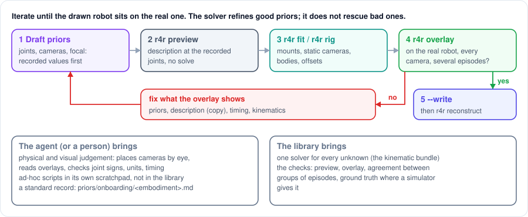
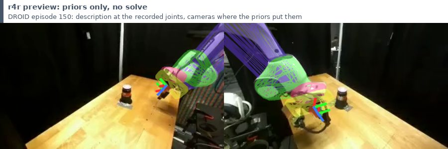
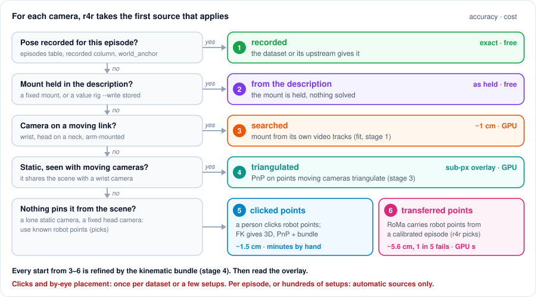
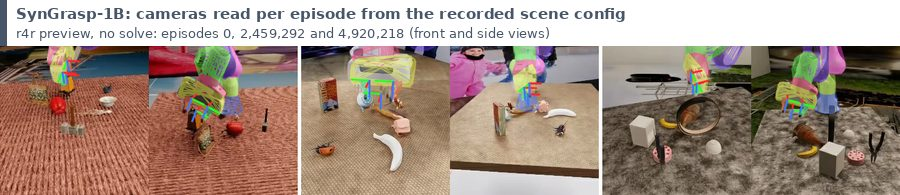
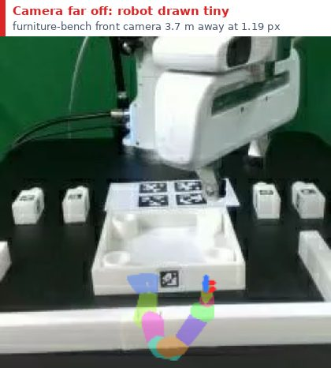
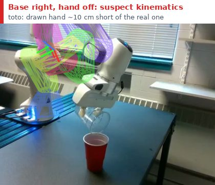
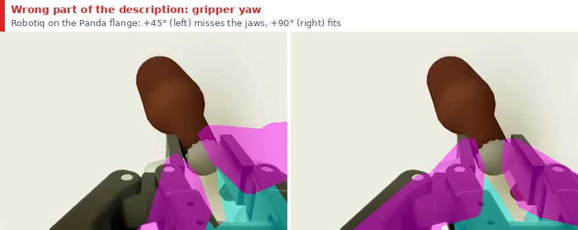
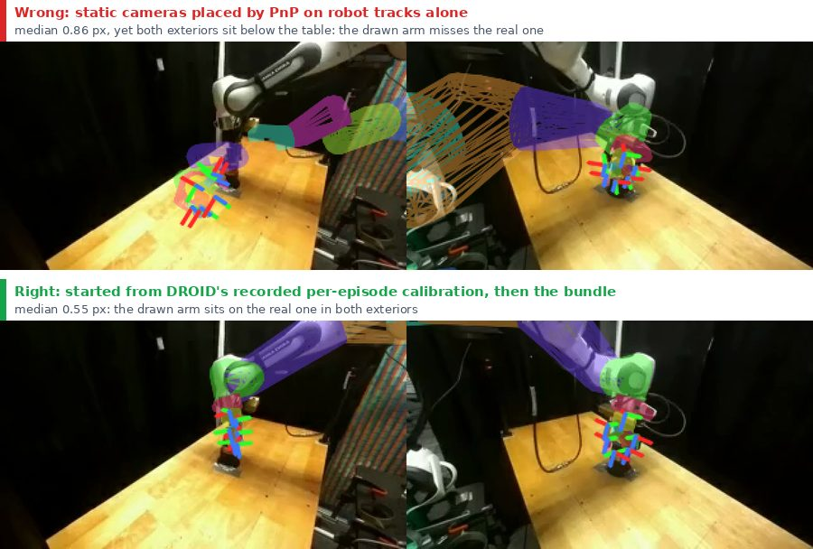

# Onboarding a dataset

What an agent (or a person) does once per dataset, before r4r processes all of its episodes.
The goal: a priors file (`priors/<family>/<dataset>.json`) and settings that run unattended at
scale. Everything is tried on a handful of episodes; mass processing reuses the result.

Keep this guide current. Legend: ✅ tool exists · ⬜ planned (by hand or `research/` scripts).



## The agent works first

The first and main step is the agent itself looking at the data and the simulated robot, and
setting as priors everything that can be set that way, before any optimisation.

- `r4r preview <dataset> check.png` ✅ draws the description at the recorded joints over every
  camera, cameras where the priors put them (no solve). Place each camera by eye (link, rough
  position, view direction); check joint signs, units, timing, the focal (is the drawn robot
  the right size?), the arm bases. Re-render until the drawn robot sits close to the real one.
- Ad-hoc scripts (state plots, frame grids, quick fits) live in the agent's scratchpad, not in
  the library.
- Record the result in the standard format: the priors JSON (values) and
  `priors/onboarding/<embodiment>.md` (what was checked, how, evidence; template
  `priors/onboarding/TEMPLATE.md`).



Only then calibrate: the solver refines good priors; it does not rescue bad ones.

## Toolbox

What exists to get each quantity, what it costs, and where it is known to fail (2026-11-16).
✅ in the library · 🧪 being tested (scratch or an agent branch) · ⬜ idea.

**Robot model and state** (first: every camera inherits their errors)

| tool | gives | notes |
|---|---|---|
| ✅ `r4r inspect`, `r4r preview` (`.png` / `.mp4`) | the description at the recorded joints over every camera, from the priors only | the agent's first look: joint signs, units, lag, focal, mounts |
| ✅ corrected descriptions `priors/descriptions/<embodiment>/` | missing parts, gripper length and rotation, mounts, link lengths | the most frequent real-data fix (G1/G2 wrist sections, Franka hand, OpenNeoData gripper, HSR fingertips) |
| ✅ priors `joints` (map, offsets, clip), `kinematics` (fitted offsets), groups (`groups.<name>.match`) | joint mapping, encoder zeros, per-episode-group robots | joint offsets only when disjoint fits agree |
| ✅ family-level priors (`priors/<family>/family.json`, types matched on `meta/info.json`) | one priors file per robot type for families of many single-episode roots | RoboBrain-X0; [checklist](#checklist) |
| ✅ `r4r fit --shifts` | video/state lag | |
| ✅ recorded EE pose vs FK | checks the joint map and units | agreement shows consistency with the vendor model, not with reality |
| 🧪 motion-agreement check | state/video mismatch per episode (wrong or desynchronised states) | G1: ~10 % of episodes |

**Camera pose and intrinsics**

| tool | gives | scope | notes |
|---|---|---|---|
| ✅ recorded values (features, upstream calibration files, `world_anchor` compute-on-load) | pose, intrinsics | as recorded | check them: G1 hand extrinsics and DROID exteriors were wrong per episode |
| ✅ `r4r focal` (ARROW) | focal estimate | per camera | ~20 % off on several head cameras; recorded intrinsics first |
| ✅ `r4r rig` (kinematic bundle on scene tracks, RoMa links) | moving mounts, focals, static cameras, arm bases | dataset or station | residuals do not prove the pose (static cameras far off at < 1 px); `--picks`, `--picks-weight`, `refine` |
| ✅ `r4r fit` | one camera or mount on a few episodes | dataset | |
| ✅ light route (`r4r reconstruct`, episode scope) | a static camera per episode from wrist-camera matches | episode | lands 2-24 cm off when the static camera sees the robot only at the edges |
| ✅ `r4r stations` (`--per-camera`), per-camera setup keys `station.<camera>` | which episodes share a placement | dataset | thumbnail distance: confuses background changes with camera moves |
| ✅ `r4r station` (`--seeds`, `--only`, `--focal-std`) | a station's camera from neighbour stations | station | works when stations are close; 1/8 in leave-one-out on robocoin |
| ✅ clicks → `r4r rig --picks` / hand PnP | robot points in a frame | once per dataset or a few setups | never per episode or per setup at scale |
| ✅ `r4r picks` (RoMa v2 keypoint transfer) | clicked points carried from a calibrated frame to new episodes, no new clicks | per setup | ~5.6 cm median, ~20 % failures on SynGrasp; best for small scene changes |
| 🧪 silhouette refinement (SAM 3 masks + projected mesh, `sam3-overlay` env) | a per-setup static camera | setup | lane02 43 → 23 px, 5b28 46 → 19 px; fails on clutter; meshes in the solve only here |
| 🧪 DINO part keypoints | per-episode pixel error and a small rotation correction | episode | target: G1 head yaw, HSR per-robot head |
| 🧪 geometric setup clustering (DINO + homography on background) | placements regardless of background | dataset | to replace thumbnail distance |
| 🧪 rest-pose template | camera shift per period from the robot at rest | period | HABIT: 139 periods |

**Validation** (an episode is right only when one of these says so)

| tool | measures | notes |
|---|---|---|
| ✅ ground truth (sims, recorded poses) | cm / deg | `docs/verification.md` |
| ✅ held-out clicks (`python -m r4r.viz.clicks sample / sheet / score / redraw`) | px error of drawn fingertips | the bar: median ≤ ~15 px at 512 px on ~10 held-out episodes; ±5-10 px click noise; `redraw` re-scores old clicks on a new reconstruction |
| ✅ overlay videos | visual check | read several episodes; they overstated accuracy when read alone |
| ⬜ RoMa-transferred validation clicks | click once on a validated frame, carry the points to other episodes of the setup | cheaper validation per setup; needs a transfer-failure check |
| 🧪 automatic scores (motion agreement, edge alignment, mask IoU, DINO robot features) | per-episode error estimate without clicks | to be calibrated against the click sets before use |

## Step by step

| # | step | command | done when |
|---|---|---|---|
| 0 | in scope? | `r4r inspect <dataset>` | it runs; joint states and a description exist |
| 1 | kinematics | `r4r inspect … --episode N`, `r4r sheet <dataset> out.png` | no unmapped varying column, no joint past its limits, skeleton moves like the video |
| 2 | timing | `r4r fit <dataset> <camera> --shifts -3 -2 -1 0 1 2 3` | one shift wins clearly on 2–3 episodes → `state_shift` |
| 3 | cameras | `r4r links`, `r4r sheet`, the dataset's metadata | static/moving, link, focal, lens, scope decided for each |
| 4 | draft priors | edit `priors/<family>/<dataset>.json` | `r4r preview` puts the drawn robot close to the real one |
| 5 | moving mounts | `r4r fit <dataset> <camera> --episodes … --write` | most episodes agree |
| 6 | whole rig | `r4r rig <dataset> --episodes … --groups 2 --save sol.pt` | groups agree (mm, 0.1° for dataset scope) |
| 7 | **overlay** | `r4r overlay sol.pt check.png`, `… episode.mp4 --episode 0` | robot on the real one, every camera, several episodes |
| 8 | write | `r4r rig … --write`, `r4r export <dataset> robot.xml` | priors and record committed; metadata bugs in `priors/ISSUES.md` |
| 9 | every episode | `r4r reconstruct <dataset> --plan`, then `r4r reconstruct <dataset> out/ [--shard i/n]` | the plan says fast/light for (nearly) every episode; one parquet per shard, route and check per episode in its metadata |
| 10 | check against the video | `r4r check <dataset> out/ [--episodes …]`, then `r4r merge` | few episodes flagged out of sync; read the overlay of each flagged one and of the highest camera error estimates ([below](#automatic-checks-r4r-check)) |

### Draft priors

A minimal priors file (trimmed from `priors/droid/droid.json`):

```json
{
  "description": "descriptions/franka__panda/panda_robotiq.urdf",
  "joints": [{"index": 7, "urdf_joint": "gripper_finger_joint", "from": [0, 1], "to": [0, 0.725]}],
  "cameras": {
    "wrist_left": {"mount": "moving", "link": "panda_link8",
                   "position": [-0.0769, 0.0326, 0.0181], "orientation": [0.6963, -0.1177, 0.1221, -0.6965],
                   "position_range": 0.03, "orientation_range_deg": 5.0, "focal": 183.0, "focal_range": 0.01},
    "exterior_1_left": {"mount": "static", "scope": "episode", "focal": 131.0, "focal_range": 0.02,
                        "position_range": 0.05, "orientation_range_deg": 3.0}
  }
}
```

## Placing each camera (step 3–6)

Same order as the README's [How each camera gets its pose](../README.md#how-each-camera-gets-its-pose):
take the first source that applies.



| # | source | how to set it up | accuracy |
|---|---|---|---|
| 1 | recorded | episodes table pose columns, a pose `column` in the camera prior, or world-frame records with `world_anchor` ([below](#per-episode-table-priorsfamilydatasetepisodesparquet)) | exact |
| 2 | from the description | `position` / `orientation` with zero ranges, or values `r4r rig --write` stored | as held |
| 3 | searched | `"mount": "moving"` and its `link`; `r4r fit`, or rig stage 1 | ~0.3–1.3 cm on sims |
| 4 | triangulated | `"mount": "static"`, no pose; rig stage 3 runs PnP on moving cameras' points | sub-pixel overlays |
| 5 | clicked points | a picks JSON, `r4r rig --picks` ([below](#cameras-the-scene-cannot-pin-robot-keypoints)) | ~1.5 cm, 8+ picks |
| 6 | transferred points | `r4r picks` from calibrated references, then `r4r rig --picks` ([below](#picks-without-clicks-r4r-picks-keypoint-transfer)) | ~5.6 cm median, ~20 % fail |

**Clicks are for calibration, not for scale.** Clicked points and by-eye placement (`r4r
preview`) calibrate a dataset once, or a handful of setups. Per-episode results, and setups that
number in the hundreds, must come from automatic sources: recorded values, held calibration,
odometry, the light solve, transferred points, with the fit check. A dataset whose per-episode
cameras need clicks is not solved for those cameras.

## Checklist

| area | check | where it goes in the priors |
|---|---|---|
| joint mapping | varying state columns that drive nothing → a missing joint | `joints`: index, URDF joint, `sign`, optional `from`/`to`, optional `clip` [lo, hi] (a gripper motor closing past finger contact on a spring: HSR) |
| signs, offsets | joints outside their limits → wrong sign, offset or unit | `sign`, a `from`/`to` range |
| dropped features | joint states (or other columns) the delivery dropped but the upstream keeps: build a side table (sharded parquet, `episode_index`, `frame_index`, the feature; a row group per episode) outside the delivery | `side_table` (a directory), then `state_feature` lists the side feature after the delivered one and `joints` index the concatenation (nvidia-kitchen-demos: `priors/nvidia-kitchen-demos/build_side_table.py`) |
| units | degrees converted automatically; `normalised_percent` needs a range per joint | `joints[].from/to` |
| description | wrong gripper, wrong arm, wrong arm mount or layout, link lengths, single-arm file for bimanual data, unreadable meshes; none delivered (no `meta/robot.json`: robocasa365, robotwin-unified) | `description`: corrected copy under `priors/descriptions/<embodiment>/` (a simulator's own URDF when there is one). A prior like any other: the agent fixes it itself and iterates until the overlay is right, never leaves it as a blocker. Without `robot.json` the state is `observation.state` and every joint comes from the priors' `joints` |
| timing | video/state lag (`r4r fit --shifts`); sub-frame part refined later | `state_shift`, `kinematics.time_offset_frames` |
| encoder offsets | small remaining errors, refined in every `r4r rig` bundle | `kinematics`: `joint_offset_deg`, `joint_offset_mm` |
| camera link | metadata often wrong; `r4r links` gives still share and rotation residual per body | `cameras.<name>.mount`, `link` |
| focal | recorded first (below), estimated last | `focal`, `focal_range` (0 by default); `principal` (cx, cy) for an off-centre principal point |
| per-episode intrinsics or poses | several stations, per-unit calibrations, a dataset's own extrinsics | `<dataset>.episodes.parquet` (below) |
| lens | pinhole or fisheye, recorded coefficients | `lens`, `distortion`, `distortion_range` |
| scope | bolted (dataset), re-placed (episode), driving (frame) | `scope` on cameras and bodies |
| robots | one dataset mixing robots (RoboMIND2 agilex: Piper and ARX arms): per-episode statistics tell them apart (`meta/episodes` `stats/observation.state/q99`) | `groups`: a `match` on a statistic and the group's own description, joints, cameras (`r4r.data.priors`); `r4r stations … --group` per group |
| many roots, one robot type each | a family delivered as one root per episode (RoboBrain-X0: 35,515 roots of four upstream robot groups): one priors file per type, not per root | `priors/<family>/family.json`: `{"types": [{"match": {"info": "robot_type", "in": [...]}, "priors": "<type>.json"}]}`; a root without its own file takes the first type whose `meta/info.json` value is listed (`r4r.data.priors.priors_path`); `rig --write` writes into the type's file; the episodes table stays per root (every root's episode is 0). One root is one episode, so calibrate on several roots and hold the agreed values in the type file |
| setups | sessions where a static camera stays put: `r4r stations <dataset> <camera> --write`; cameras re-placed independently of each other: `--per-camera`, one key per camera | `station` (or `station.<camera>`) column of the episodes table; values per station in `stations` |
| odometry gain | `r4r rig --write` on driving episodes fits `base_odometry.correction` | then reconstruct holds the base on its record |
| second arm | its base placement is usually a guess | `bodies.<base>`: ranges, scope |
| mobile base | does it move within episodes? where is its motion recorded? | `bodies.<root>` at frame scope, `base_odometry` |
| anchor | keep one fixed arm or known camera | nothing free on it |

### Toolbox: do two setups share a camera placement? (`r4r stations --compare`)

`r4r stations <dataset> <camera> --compare A B C …` prints, for each pair of the episodes, how
far the static background moved between their first frames: SIFT matches on pixels that do not
change during the episode, a RANSAC homography, the median displacement of its inliers in px at
512 width, and the inlier count (`r4r.data.placements`, CPU, ~0.2 s per episode). Under ~1 px:
the camera did not move. A few px: a small re-placement. `inf`: no shared background. Use it to
decide whether two stations or runs can share one camera pose, for example robomind2
dual-franka camera_right: rig_c dates 0827 and 0829 at 0.4 px (one placement), 0410 and 0515
(the 4 cm move) at 18.8 px. Thumbnail distances could not separate these (0.73–1.0 for every pair).

Diagnostic only: it reads two episodes and writes nothing. It is not a setup detector. On known
setups (2026-11-16), grouping by it was not clearly better than `r4r stations`' thumbnail runs.
It was perfect on dual-franka camera_left A/B/C and somewhat better on abc-640 stations (ARI
0.82 against 0.76 for thumbnail clustering), but worse on HABIT. Known failures:
- **Cameras on the robot frame whose room changes** (HABIT front_view): the background changes
  while the camera stays put on the robot, so the result is `inf` or a false move. Compare the
  resting robot instead (field notes, "Mount periods from the robot at rest").
- **Plain walls and tables** (robocoin lane02 cam_high): too few background keypoints. It
  abstains (`inf`) on most pairs; `inf` with few inliers means "unknown", not "moved".

### Focal: look for a recorded calibration first

1. The delivered dataset: `info.json` camera fields, per-frame intrinsics columns, `meta/`.
2. The upstream source in `provenance.json`: raw recordings often keep it when the conversion
   dropped it (abc-130k: `foxglove.CameraCalibration` in each `episode.mcap`; ROS bags:
   `camera_info`; format docs, calibration files).
3. The camera model's datasheet.

- Check the calibration's resolution against the video's (abc-130k: K at 848×480, videos
  640×480, a centre crop). A dropped calibration goes into `priors/ISSUES.md`.
- **Estimate only then:** `r4r focal <dataset> <camera> --episodes 0 1 2` ✅ (ARROW + gen2
  adapter, 64 frames per episode, ~20 s per episode on one GPU, < 10 GB). Against simulator
  ground truth (`experiments/focal_sources/RESULTS.md`):

  | camera | median error | within 10 % | known outliers | use |
  |---|---|---|---|---|
  | static | 3 % | 9 of 14 | molmobot wide view +150–180 %, two zed2 views +30–40 % | write it as the camera's `focal` |
  | wrist | 3 % | 10 of 16 | molmobot zed-mini, maniskill 256² wrist: 60–310 % too long | plausibility check only; leave the focal free in `r4r fit` |

  Other estimators: base ARROW 18 % (static); GeoCalib 43–61 %; MoGe-2 74 % (wrists).

### Per-episode table: `priors/<family>/<dataset>.episodes.parquet`

One row per episode and camera, read by the loader ✅:

| columns | meaning |
|---|---|
| `episode, camera` | keys |
| `fx, fy, cx, cy` | intrinsics at the video resolution (null when unknown) |
| `station` | the setup; `r4r rig` refuses episodes from several stations |
| `station.<camera>` | that camera's own setup, when static cameras are re-placed independently (`r4r stations <dataset> <camera> --per-camera --write`): its values come from `stations.<key>.cameras.<camera>`, on top of the common station's |
| `x, y, z, qw, qx, qy, qz` | static camera: its pose in the base frame (OpenCV axes), where `r4r rig` starts it instead of PnP; moving camera: its mount on its link in that episode |

### Cameras the scene cannot pin: robot keypoints

Static-only rigs, fixed head cameras, a wrist that sees the other arm: click a few robot points
in a few frames and pass them to `r4r rig --picks picks.json` ✅. A point is a body's name (its
origin) or a named point of the priors or the picks file:

```json
{"points": {"tip": {"body": "panda_hand", "offset": [0, 0, 0.1034]}},
 "picks": [{"episode": 0, "camera": "front", "frame": 42,
            "pixels": {"tip": [120.5, 88.0], "panda_link4": [101.0, 60.5]}}]}
```

- `frame` is the video's own frame index (a multiple of `--stride`); points can also be named
  once in the priors' top-level `robot_points`.
- Click where the point is, not where a surface is: a joint origin is on its axis (the centre
  of the joint housing), a tip between the fingers. The description's gripper must be the real
  one for gripper points.
- Enough: 8 or more picks per camera and episode, over 4–5 frames, spread over the arm and off
  its plane. Against recorded cameras (clicks simulated with 2 px noise, one static camera per
  episode solved alone):

  | dataset | camera-episodes | picks | error median (p90, max) | no start |
  |---|---|---|---|---|
  | SynGrasp-1B, 256² | 31 | 8–20 | 1.7 cm / 1.1° (3.6 cm / 2.5°, 5.0 cm) | 1 |
  | SynGrasp-1B, 256² | 9 | 2–7 | 6–7 picks: 10–13 cm; fewer: none | 2 |
  | maniskill-sim, 256², f 128 | 9 | 25 | 1.4 cm / 1.4° (2.6 cm / 1.7°) | 0 |

  With 4 px click noise maniskill gave 4.1 cm / 4.2°: click carefully on wide views.
- Clicks are PnP starts and bundle residuals. Overlay afterwards, as always.

#### Picks without clicks: `r4r picks` (keypoint transfer)

Many sessions of one robot, each with its static camera re-placed (openneodata: hundreds):
calibrate one session, then carry robot points from it to the others with RoMa v2 ✅
(`r4r.rago.transfer`). In a calibrated reference frame the description is ray-cast through a
grid of pixels: each pixel that lands on the robot shows a known surface point (body, offset).
Each target frame is matched with the reference frame of nearest joint configuration; the warp
at the pixel is where the target sees that point, kept where RoMa is certain (overlap > 0.1) and
the warp comes back within 3 px (forward-backward check). The output is a picks file.

```bash
r4r picks openneodata/datasets/flexiv-rizon4 picks.json --camera third_view \
  --episodes 19160 19161 19162 --references 18600 18800 19000 \
  --bodies base_link link1 link2 link3 link4 link5 link6 link7 flange --stride 2
r4r rig openneodata/datasets/flexiv-rizon4 --episodes 19160 19161 19162 --stride 2 \
  --picks picks.json --save s.pt
r4r overlay s.pt check.png
```

- References: episodes where the camera's pose is known (episodes table, pose column, or the
  priors' pose); `--reference-dataset` takes them from another root of the same robot. Many
  reference episodes (joint configurations) matter more than anything else (table below).
- Bodies: those whose geometry is the real robot's. Leave out a description's gripper when the
  real one differs (openneodata).
- For the target sessions the camera must be free in the priors (no pose, or ranges wide
  enough): `r4r rig` gates a PnP start by the priors' ranges.
- Surface points, not named ones: a joint origin lies inside its housing, so the warp carries
  the surface in front of it, which projects on the origin only from the reference's viewpoint.
- Cost: ~2 s of matching per camera-episode (16 frames, GH200), 40–90 s per 3-episode session
  with decoding and model loading; the solve is CPU.

Against SynGrasp-1B's recorded cameras (256², 25 episodes × 2 static cameras, each solved alone
from its transferred picks; references: the same camera in 40 other episodes, its pose
randomised per episode by up to 25 cm / 14°; frames 16 per target unless said):

| variant | camera error median | < 2 cm | < 5 cm | > 20 cm | pick error median |
|---|---|---|---|---|---|
| named points (body origins) | 23 cm / 21° | – | 2/50 | 27 | 12.5 px |
| surface points, 48 per frame, crop | 5.9 cm / 4.1° | 6 | 18/50 | 11 | 6.7 px |
| surface, whole reference frame | 6.9 cm / 5.0° | 8 | 17/50 | 11 | 6.8 px |
| surface, references of both cameras | 7.0 cm / 5.4° | 3 | 20/50 | 12 | 6.1 px |
| **surface, 96 per frame (default)** | **5.6 cm / 4.2°** | 10 | 22/50 | 9 | 6.6 px |
| same, 8 target frames | 6.3 cm / 5.5° | 8 | 21/50 | 11 | 6.7 px |
| same, 4 target frames | 7.9 cm / 5.7° | 4 | 19/50 | 15 | 6.6 px |
| surface, 4 reference episodes | 123 cm | 1 | 5/50 | 31 | 9.6 px |

Clicks simulated with 2 px noise gave 1.7 cm on the same data: transferred picks are 3× less
accurate and fail (> 20 cm) on about a fifth of camera-episodes. Use them as a start; read the
overlay of every session. On openneodata (real, 512×384, 5 sessions per arm, one station of
references for flexiv, two for ur5e) the drawn arm sat on the real one in 7 of 10 sessions,
the wrist a few cm off in 2, and 1 showed only the gripper (not checkable); picks reproject at
3.8–12.9 px median (onboarding records `flexiv__rizon4`, `ur__ur5e`).

PnP on robot tracks alone can land a camera far off and still fit (DROID: exteriors below the
table at 0.86 px). Images alone do not pin a per-episode mount (RB-Y1: a wrist 25° off at 0.7 px).
A moving camera with per-episode pose columns gets `"scope": "episode"` and a tight range.

Too many episodes for a table? When the dataset records each episode's camera pose in a JSON
string column (SynGrasp-1B, 4.9M episodes), the camera prior names it instead ✅:

```json
"pose": {"column": "publisher.episode.extra_info",
         "path": ["environment_config", "camera_info", "name=side_rand_small"],
         "axes": "forward_left_up"}
```

`key=value` picks a list item; `axes` is `opencv` or Isaac Sim's x-forward, z-up camera axes.



### Lens

| lens | coefficients (recorded first) | missing |
|---|---|---|
| `pinhole` (default) | OpenCV radial `[k1, k2, k3]` (from `distCoeffs` drop `p1, p2`) | ideal pinhole |
| `fisheye` | Kannala–Brandt `[k1, k2, k3, k4]` (ROS `equidistant`, RealSense `kannala_brandt4`) | refined from the equidistant model with a wide prior; focal = pixels per radian (0.7 × width is a fine start) |

`distortion_range` is the prior std per coefficient (0 holds them). Coefficients do not depend
on the video resolution. Other models (rational, Double Sphere, FOV) must be converted.

### Bimanual and mobile

```json
"bodies": {"right_base": {"position_range": 0.2, "orientation_range_deg": 20, "scope": "dataset"}}
```

- **Bimanual:** free the second arm's base; keep the first as the anchor; episode scope if it
  moves between episodes. Pool ~20 episodes (abc: 10 episodes 1.5 cm, 20 episodes 0.3 cm).
- **Mobile:** free the root body at frame scope (e.g. 0.05 m / 3°, a random walk) and say where
  its motion is recorded (`base_odometry`):

  | kind | recorded as |
  |---|---|
  | `pose` | planar x, y, θ columns (simulators, odometry); or a full pose: x, y, z with a quaternion (w, x, y, z) or roll, pitch, yaw |
  | `velocity` | body-frame vx, vy, ω |
  | `caster` | wheel angles left, right[, steering], with radius, half track, steering offset |

  Validate it against an on-robot camera's rotation where the camera's joints are still
  (commanded turn rates can be poor: HSR). First check whether the base moves within episodes
  at all. Legged odometry (stance foot) ⬜.

## Tune on the sample, then freeze

| setting | effect | start with |
|---|---|---|
| frames (`--stride`) | more frames: cleaner tracks, more time and memory | every frame for KLT |
| episodes per setup fit | the main lever for dataset-scope unknowns | 5–20 |
| RoMa links (`--every`) | what pins arm bases and static cameras | every 0.3–1 s |
| agreement tolerance (`r4r fit --agreement`) | which episodes count as agreeing | 2 cm / 2° |
| focal range | 0 when known | 0 |

Record what you chose and why in the priors' `notes`.

## Read the overlay

**Required.** Residuals and group agreement are not enough: on sim-panda a static camera 145 cm
off still fitted at 0.83 px (its own tracks fit any pose). An agent reads the PNG grid; a person
watches the video. The robot must sit on the real one in every camera, every frame, several
episodes.

| what you see | likely cause | fix |
|---|---|---|
| right place, trailing the motion | time offset | `r4r fit --shifts`, `state_shift`, `kinematics.time_offset_frames` |
| right at the base, wrong along the chain, in every camera | kinematics: mapping, sign, offset, sag, wrong description | fix the model (agent's work per dataset) |
| right in some cameras, wrong in one | that camera's mount or pose | its link, start pose, range, a recorded calibration |
| robot drawn tiny or huge | a camera far off, or the focal | the camera's start; the focal source |
| arm right, gripper or hand wrong | the description's gripper, its attachment | a corrected description; compare candidates over a wrist frame |
| surfaces missing or odd | simplified or missing meshes | judge the skeleton and end-effector frames too |

<table>
<tr>
<td width="50%"></td>
<td width="50%"></td>
</tr>
<tr>
<td colspan="2"></td>
</tr>
<tr>
<td colspan="2"></td>
</tr>
</table>

⬜ `r4r report`: per-camera residuals, inlier share, agreement across episodes, held-out
episodes, with the overlay.

### Automatic checks: `r4r check`

After `r4r reconstruct`, `r4r check <dataset> out/` compares every episode with its own video,
independently of the solve (CPU, ~0.2–2 s per episode; `src/r4r/checks/`). It writes
`checks.parquet` beside the shards, and `r4r merge` copies it into `meta/r4r.json`.

- **Sync** (flag). For 16 frame pairs, it compares how much the image changes with how much the
  state says the robot (static camera) or the camera itself (wrist, head) moves. `ρ` is the
  rank correlation of the two. An episode whose mean `ρ` over its cameras is below 0.35 is flagged: its state does
  not drive its video. This happens with a state from another episode, streams out of step, or
  a wrong lag. Static cameras on fixed arms separate cleanly; head cameras on humanoids and
  mobile bases less so.
- **Camera error estimate** (reported, not a flag). It is the 2D shift that best puts the drawn
  robot's outline on the image's edges, or its moving silhouette on the image change. It finds
  a camera 30+ px off with AUC ~0.85 against clicked fingertips. It misses errors that sit only
  in the end effector (gripper length, jaw model). Use it to rank episodes for a look, not as
  a verdict, and never as a correction: the shift does not reduce held-out click error.

Numbers and what failed: [verification](verification.md#automatic-per-episode-checks-2026-11-16).

## Lessons so far

- Joint states can be commanded rather than measured (xrobotwin): FK is off while the arm moves.
- Simulators may randomise mounts and focals per episode (molmobot, interndata): declare
  episode-scope ranges, use the recorded values.
- A failed moving-camera fit often comes with an inflated focal, but the focal is rarely the
  cause: on simulators with ground truth, the exact focal rescued 2 of 12 failing fits. Check
  the kinematics (lag, unmodelled joints, sag) first. A recorded focal still removes one unknown.
- One episode rarely pins down an arm base: pool episodes.

More, dataset by dataset: [`field-notes.md`](field-notes.md) and `priors/onboarding/`.
