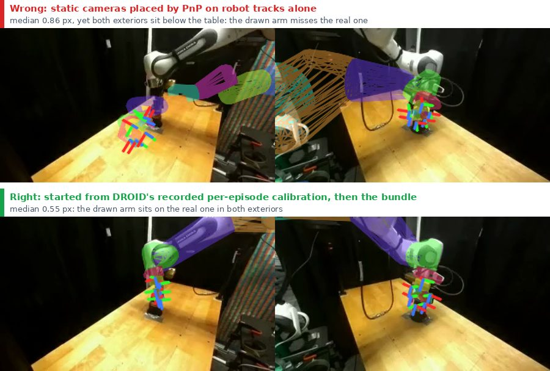
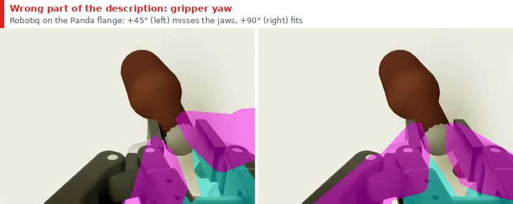
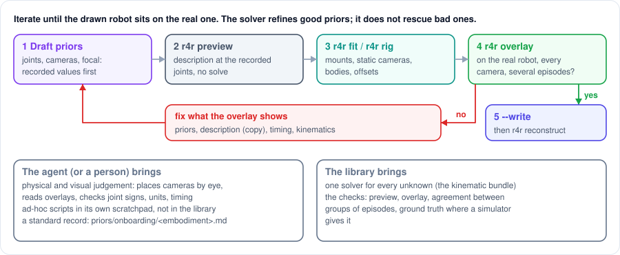
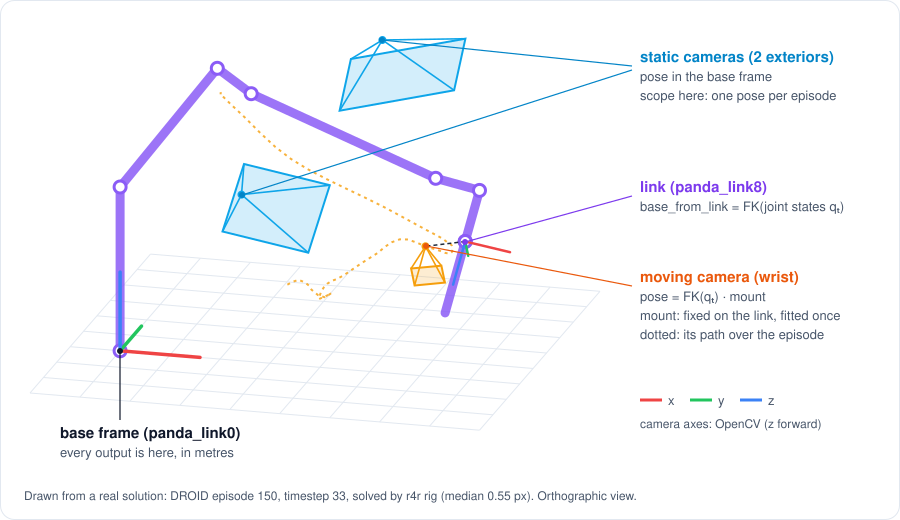
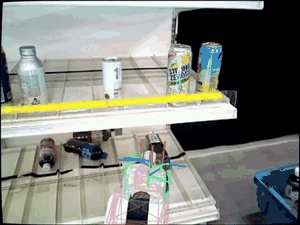
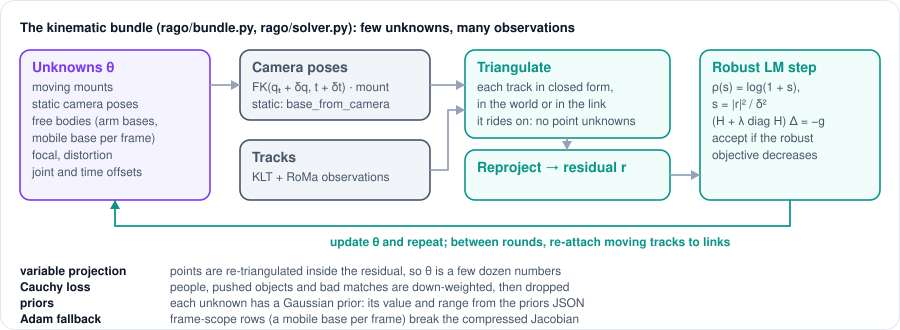
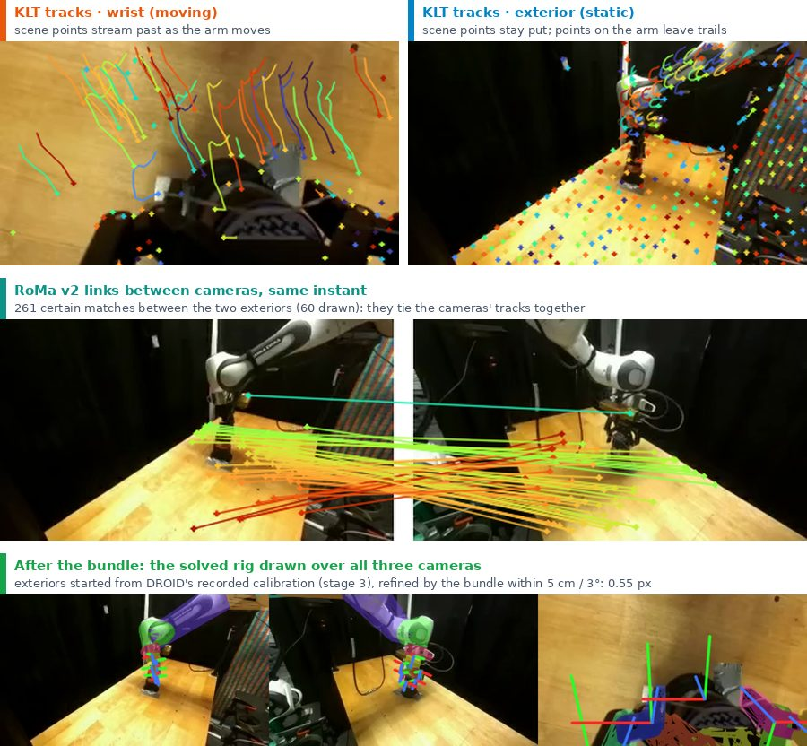

# Field notes: from a dataset to cameras, kinematics and 3D

Raw tips and tricks collected while onboarding datasets (by people and agents), to be
consolidated later into `docs/dataset-onboarding.md`. Add to it whenever something non-obvious
is learnt: what happened, how it showed, what fixed it, which dataset. Per-embodiment details
stay in `priors/onboarding/<embodiment>.md` (section "Tips and tricks"); general lessons here.

| [Checking results](#checking-results) | [Inputs](#getting-the-inputs-right-before-any-solve) | [Timing](#timing) | [Cameras](#cameras) | [Bimanual and mobile](#bimanual-and-mobile) | [Compute](#compute) | [Tools](#tools-and-models) |
|---|---|---|---|---|---|---|
|  |  |  |  |  |  |  |

## Checking results

- **Look at the overlay, always.** Residuals and group agreement are not enough. Seen:
  - sim-panda's static camera was 145 cm / 68° off at 0.83 px;
  - DROID's exteriors were placed below the table at 0.86 px;
  - InternData-M1's static cameras were 11.5 cm / 6.5° off at 0.93 px;
  - an RB-Y1 wrist mount was 25° off at 0.7 px.

  A static camera's own tracks fit any pose (all its rays leave one centre); only links to the
  moving cameras and the robot pin it.
- **Draw surfaces, not just axes.**
  - A URDF with visual meshes only drew nothing until visual meshes were kept for drawing (abc).
  - COLLADA visuals can't be read: fall back to collision meshes per link (HSR, Panda, RB-Y1).
  - Axes alone hid a wrong abc calibration.
- **Read the overlay by failure pattern:**
  - right place but lagging the motion: timing;
  - right at the base, wrong along the chain in every camera: kinematics;
  - wrong in one camera only: that camera.
- **Check that recorded values reach the solver:** a loader that dropped per-episode mounts and
  a rig that used episode 0's focal for all episodes both failed silently under 1 px. Only a
  per-episode comparison with ground truth or a careful overlay caught them.
- **A low residual can come with an absurd pose:** a static camera placed ~300 km away at
  1.35 px (community SO-101). Starts farther than 10 m from the base are now rejected.
- **Ground truth where it exists.** Simulators that ship camera poses (sim-panda, maniskill,
  molmobot, InternData) measure real error: always compare before trusting a method.

## Getting the inputs right (before any solve)

- **Recorded calibration first.** Look in the delivered metadata, then the upstream source:
  - abc: `foxglove.CameraCalibration` in each upstream `episode.mcap`;
  - InternData-M1: upstream annotations, exact to 0.000 px;
  - DROID: ZED factory intrinsics and DROID's own per-episode extrinsics;
  - molmobot: per-frame extrinsics and render intrinsics.
  - SynGrasp-1B: per-episode cameras, robot placement and objects in a JSON string column
    (`publisher.episode.extra_info`) that `info.json` doesn't describe: read free-text columns.
  - Recorded camera names can be swapped against the video streams (SynGrasp-1B, upstream):
    project recorded 3D object poses and compare with the dataset's 2D boxes per stream.
  - Isaac Sim camera orientations saved with its "world" axes are x forward, z up (not
    USD's -z forward).
  - Upstream annotations can replace missing camera fields: InternData-M1 publishes the 2D
    projections of a few known 3D points per camera; solving the projection from six points
    gives exact intrinsics and poses.
- **Hunt the upstream for calibration before solving:** RealSource-World's upstream
  `meta/camera.json` has per-episode hand-eye and K (ready with no solve); HRDexDB ships
  `C2R.npy` + camera parameters. Hand-eye names don't say which frame is which: render the
  transform and its inverse on the candidate link and pick by overlay.
- **Put a head camera on the link its calibration refers to** (e.g. the arm base): unrecorded
  head and lift joints then don't matter.
- **Check recorded extrinsics over all episodes, not the first few:** AXIS re-places the camera
  in a third of its episodes. **Count frozen-state episodes** before calibrating (robomind
  ur5e-real: the arm state is frozen in 89% of episodes).
- **Read the description's header comments:** petaldex's says its arm kinematics are invented.
- **Measure, don't eyeball, image geometry:** robomind2's letterbox looked asymmetric in a
  thumbnail and is symmetric when measured. Read the data-collection code for resizing
  (FurnitureBench squashes the wrist to 224x224 but crops the front camera).
- **End-effector columns of simulators name their frame:** M1's EE position equals FK of
  `panda_link8` exactly, a quick check of the joint mapping.
- **The rotation test cannot tell quaternion orders apart:** the angle between two quaternions
  survives any consistent permutation of their components (robomind2 dual-ur5: xyzw and wxyz both
  2.2°). Check the order with positions or a full-pose fit.
- **No recorded end-effector pose? Use a wrist camera's own rotation:** the rotation angle between
  two frames from the essential matrix gives the same test (robocoin lane10: plain mapping 2.5°,
  best ±90° class 0.7°). It narrows a sign/offset search to a family; positions must pick one.
- **Check recorded EE positions in the controller's own base frame:** UR's `base` is `base_link`
  turned 180° about z; FK of tool0 then reproduced robomind2's `eef_pose` xyz to 1 mm.
- **Test the arm model first whenever an end-effector pose is recorded:** between two frames,
  the end effector's rotation angle equals the correct FK link's, whatever the base and tool
  offsets. That separates the right model (0.000°) from a wrong one (1.7–5°) in seconds; then
  solve the base and tool offsets. For joint sign errors, try all 64 sign patterns. Most
  "AgileX ALOHA" data is really Piper arms; some "AgileX" data is ARX X5.
- **The table gives each arm's "up" from the joint states alone:** take the fingertip (FK of the
  flange plus the gripper length) at every gripper-closing moment over the dataset; on a tabletop
  dataset they lie on one plane (robomind2 dual-ur5: 25k grasps per arm, 6–7 mm median off it,
  the gripper pointing straight down at 0.95). Search the direction where the heights have the
  smallest spread: its normal is the true up in that arm's base frame, the level is the base height
  above the table. It showed the dual-ur5 bases tilted 45°, not hung upside down as they looked,
  and gave both arms the same table height (0.749 / 0.751 m). Clicked joint origins on the same
  rig gave nothing usable (PnP 7–30 px, focals at the scan bounds).
- **Arm-type and side labels are unreliable:** per-episode joint ranges reveal the arm type and
  mixed datasets (Piper joint 3 always negative, ARX positive). For left/right, use an episode
  where one arm moves and a static view (camera facing the robot: image right is robot left).
- **Look at every camera of an episode side by side:** some openneodata episodes pair wrist and
  third-view videos from different recordings.
- **Recorded end-effector poses check the description for free:** they validate the joint
  mapping and locate arm bases exactly (groot: right arm 1.2 m from the description, 0.000 cm
  residual after correction). Solve for the end-effector point's offset too: it is rarely the
  hand origin, and ignoring it looked like a 5 cm error.
- **The simulator's own model can differ from the delivered description** (robosuite's GR1 head
  chain is 14 cm lower): re-express source cameras through a body both models share.
- **Check every URDF for an embedded `<mujoco><compiler>` block** (G1, H1-2, Kuavo): it overrides
  r4r's compiler settings and fuses fixed links (pelvis, camera links) away.
- **Compare robot.json's `arms` lists against its `joints`:** they can disagree (DexMimicGen
  can-sort: 133 mm residual, 0.2 mm after the fix).
- **Peek one frame of every camera before trusting names:** grail's video shows the synthetic
  human source, not the robot.
- **Simulators define their cameras in source code** (robocasa's camera config, robosuite scene
  files). MuJoCo cameras to OpenCV: flip y and z. Focal from the field of view and the rendered
  height, not the padded one; letterboxed videos need the focal of the content area.
- **Sample episodes from the first, middle and last data files:** setups and randomisation
  showed up only that way (interndata b090: two head-camera positions, unlabelled).
- **Index-like names can mislead:** RoboInter's `source_episode_name` is not DROID-3D's
  `traj_id` (joined poses 10–120 cm apart). Verify any join against the images.
- **Triage by feature names first:** reading each feature's `names` blocked ten Open
  X-Embodiment sets (no joint states) in minutes.
- **Check the calibration's resolution against the video's.** Crop vs resize differ:
  - abc: 640x480 is a centre crop of 848x480;
  - molmobot: 480x480 render shown as 512x288;
  - furniture-bench: 1280x720 squashed to 224x224, so non-square pixels;
  - robomind2: letterbox padding.
- **Joint mapping is often wrong in the metadata.** community-v3 maps the description's
  movable joints in file order, giving wrong joints and indices past the state width. Read the
  state `names`; check units (degrees, normalised percent, LeRobot-calibrated degrees with
  unknown offsets).
- **The description can be wrong:**
  - the wrong gripper (DROID and M1 have a Robotiq, not a Franka hand);
  - the wrong arm (Trossen AI data on a ViperX description);
  - single-arm descriptions for bimanual data;
  - meshes in unreadable formats.

  Fix it in a corrected copy under `priors/descriptions/<embodiment>/`, never in the delivery.
- **Gripper meshes are often not the real gripper** (Robotiq, dexterous hands): judge wrist
  cameras by the links up to the hand.
- **Gripper attachment angle:** check it against a view where the wrist mount is known. The
  Robotiq on the Panda flange was +90°, not the +45° chosen by eye at first.
  Project the flange axis into that view: the jaw centre must lie on it, which separates a
  wrong mount from a wrong gripper attachment.
- **Grafted descriptions:** when a borrowed part has visual meshes and the original arm's
  don't load, overlays draw the part and no arm. Point the arm's visuals at its collision
  meshes (the overlay now also falls back per link).
- **Ground truth can expose description errors:** express the delivered camera pose in its link
  through FK. A mount that drifts within an episode while its rotation stays fixed points to a
  wrong link length (RB-Y1 shoulders 2 cm too low); translation-only drift on one moving arm is
  geometry, not timing (a lag would also rotate it). A least-squares fit of link-origin
  corrections plus per-episode mounts finds it.
- **Take recorded per-episode values from a middle frame** and check them against a second
  frame: a few first frames are off by centimetres (molmobot).
- **Simulators randomise:** mounts per episode (molmobot: 1–5 cm, 4–10°), focals, robot base
  placement (InternData-M1: ±5 cm). Use episode scope and the recorded values when they exist;
  images alone don't pin a per-episode mount.
- **Merged roots mix setups:** community-v3 roots join many LeRobot repos, each with its own
  cameras and calibration (one root's overlay showed three rooms). Find the setup key first
  (`source/subtree` or `source/publisher_repo` in `meta/episodes`), write it as `station`, and
  never calibrate across setups.
- **Read the recorder's definition of zero first:** old LeRobot calibrates 0 = arm straight and
  horizontal, +90 = "rotated"; that gave the whole Koch joint map at once (lift − 90°, 90° − elbow,
  −wrist), the images only confirmed it. New-LeRobot normalised states (−100..100) have no scale
  without the per-robot calibration file (full-turn motors only: 1.8° per unit).
- **Don't judge a joint map from one start-pose silhouette:** with the wrist at −90 the Koch rest is
  a tall stack, at 0 the gripper lies on the table; an oblique "top" camera stretches a vertical arm.
- **Pan and roll zero offsets don't block pooling:** a static camera's pose absorbs the pan zero, a
  wrist mount after the roll joint absorbs the roll zero.
- **A grafted hand's joint limits check the recorder's order:** `r4r inspect` lists the joints past
  their limits (LEAP on xArm7: DIP values curl past 2.04 rad while PIP stays near 0).
- **Two arms of one description implying two body poses:** refit each shoulder origin from its own
  arm's fit and put the body at their mean (xrobotwin yumi: arms 7.6 cm / 8° apart before; 1 / 6 mm
  end-effector error after).
- **Look at a known view before grafting a hand:** a downscaled OmniPicker (two linkage plates per
  jaw) looks like a four-fingered hand (robocoin lane10). Read the dataset card and `source/dataset`:
  RoboCOIN lanes merge vendors (lane10 is 94% iSoftStone Tianqin A2 under an AgiBot G1 label).
- **"Invented" descriptions often have an official one:** search the manufacturer's GitHub org
  (Tianji's `robot-assets`, CC BY 4.0, covers the Marvin line). In large asset repos list the tree
  through the API and fetch only the URDF texts and one variant's meshes.
- **Joint ranges tell wrist designs apart:** petaldex J6/J7 hugging ±60°/±90° is Marvin's CCS wrist,
  not the SRS limits the delivered file assumed.
- **A hand filling the wrist view says nothing about arm lengths:** only a static view can pick an
  arm variant (petaldex 615 vs 696 vs 809: 9.8 / 9.6 / 11.4 px on 30 clicks). Fix a hand's roll by
  rendering its four 90° rolls over one wrist frame.
- **A camera named "head" may not be on the head:** petaldex's sits 33 cm left of and 43 cm above
  the shoulders; fit it before trusting the description's head-camera frame.
- **A layout error can be a joint-1 zero:** a base yaw equals an offset on the first joint
  (unitree-z1-dual: the delivered yaw-0 mounts drew both arms reaching away; the arms face each
  other, ±90°).
- **Joint conventions from statistics:** the first-frame poses of ~1,600 SO-100/101 repos all
  start at the same folded rest pose, which settles the zero convention at once. But the most
  frequent start pose isn't always the rest pose (Koch starts stretched out): check the images.
- **Comparing two descriptions:** fit an affine joint map from one to the other; a few mm of
  residual means the same kinematics (SO-100 vs SO-101: 7 mm).
- **States may be commanded, not measured** (xrobotwin). Or absent: many Open X-Embodiment
  sets record only the end-effector pose. With no joint states there is no FK, so blocked.

## Timing

- **Measure the video/joint lag on every dataset** (`r4r fit --shifts`): abc's states lag
  ~2.3 frames, the main cause of its wrist-mount scatter. Confirm on a second station or
  setup; it can differ. Then free the sub-frame part (`kinematics.time_offset_frames`).
- **Measure the lag from the video, not from shipped camera poses:** interndata's shipped poses
  matched the state, yet the video lagged by one frame.
- **Solve joint offsets and the time offset together:** with the time offset held, joint
  offsets absorb the timing error and come out wrong.

## Cameras

- **Place cameras by eye first** (`r4r preview`), then calibrate: the solver refines good
  priors, it doesn't rescue bad ones.
  A look-at helper (camera position + target point) speeds this up. If the base lands right
  but the hand stays off, suspect kinematics or the focal before the camera (toto).
- **A "static" camera can move in the robot frame:** InternData-M1's cameras are fixed in the
  scene but the robot base is re-placed ±5 cm per episode. Model the cameras fixed for the
  dataset and the base free per episode.
- **Gate PnP starts with the prior:** PnP from wrist-triangulated points can land metres away at
  a low residual (interndata head camera 0.7–2.4 m off at 2.27 px).
- **Per-episode focals:** one focal per camera across episodes silently breaks every episode but
  the first in a randomising simulator, while the pooled residual stays low (molmobot 0.47 px).
- **A per-episode reference calibration is only a start:** DROID's own calibration is off in
  some episodes, and the rig can drift on a dark episode where it is right. Tight ranges, and
  read every episode's overlay.
- **Where a range is measured from:** a dataset-scope camera's range is measured from the
  description's (prior) pose; an episode-scope camera's from that episode's start (recorded or
  estimated placement). Ranges on a camera with no prior pose used to pull it towards the robot
  origin (DROID exteriors 12–22 cm).
- **A consistent offset across episodes points at the reference, not the episodes:** M1's free
  base came out ~3 cm low in all 4 episodes; suspect the frame the placement was derived from.
- **A mount written in the priors is not searched by `r4r rig`:** refine a by-eye mount with
  `r4r fit` first.
- **Static camera starts:**
  - Don't start a dataset-scope camera from one episode's PnP: take the consensus over
    episodes (sim-panda episode 0 had few links and was 1.5 m off).
  - Start from the recorded or prior pose when there is one.
- **Head cameras on pan/tilt heads:** the mount search needs head motion while the base is
  parked. HSR's head barely moves then, so its mount comes from the description's optical
  frame.
- **Wrist mounts:**
  - From one camera's video, per-episode fits scatter: pool episodes, and fix timing first.
  - The focal is rarely the cause of failures: the true focal rescues only 2 of 12 blind
    failures. Unmodelled kinematics and orientation local minima are.
- **Low stage-1 agreement (1 of 4 episodes) is the early failure signal:** residuals of 1.1–2.6 px
  came with wrong geometry several times. A wrist prior with both position and orientation is
  frozen by `r4r rig`: a rough guess then poisons the static cameras (0.5 m off at 2.6 px).
- **When the wrist mount search fails** (SO arms; humanoid hands filling the view): render
  candidate mounts over a real wrist frame and keep the one whose drawn jaws or hands sit on the
  real ones. Rendering the roll variants of a description's camera frame side by side works
  the same way. A wrist camera's image "up" usually points away from the gripper axis. It
  can't work when the camera doesn't see the jaws.
- **Hand-picked joint positions** in 2–3 frames give a static camera's pose by PnP, but only when
  the picks leave the arm's plane. `r4r rig --picks` does it in the solver (PnP start, bundle
  residuals); on SynGrasp-1B's recorded cameras, clicks simulated with 2 px noise placed a lone
  static camera to 1.7 cm / 1.1° median with 8+ picks (30 of 31 within 5 cm), but 10–13 cm with
  6–7 (table in `docs/dataset-onboarding.md`). Fewer than 6 picked points give no start.
- **A static-only rig cannot be refined from its own tracks.** Attached to links, the tracks of
  a lone static camera pulled good starts away (SynGrasp 6–11 cm → 17–32 cm; Tien Kung 20 cm
  behind its by-eye pose, its own torso then drawn over the table). `r4r rig` no longer
  attaches tracks to links when no camera moves: such a rig keeps its start unless robot
  keypoints move it.
- **KLT does not follow a robot point:** it follows a surface patch (a joint origin lies inside
  its housing, outline points slide along the link). Followed pixels were 2–4 px off the named
  point (up to 15 px at 256²); as known points they spoiled PnP, as tracks on the link they
  added nothing, and seeded where a start projects the points they made 6 of 7 starts worse.
- **Robot keypoints transfer between sessions as surface points, not named points** (`r4r
  picks`): a reference frame with a known camera, the description ray-cast at its joints, RoMa
  v2 to the target frame of nearest joints, kept where certain and forward-backward consistent.
  Joint origins carried this way were 12 px off at 256² (SynGrasp: cameras 23 cm off); surface
  points 6.6 px, cameras 5.6 cm median, 22 of 50 within 5 cm, 9 beyond 20 cm. Many reference
  episodes are what matters (4 instead of 40: median 1.2 m). Real openneodata sessions: arm on
  the real one in 7 of 10 overlays.
- **Reuse wrist mounts across datasets:** write them in one description's link frame per arm.
  Mounts measured in simulation transferred to real robots (Lift-2 → openneodata arx5,
  split-aloha → soft-fold, RoboCOIN). Same kinematics can still mean different link frames.
- **A wrist-mount search without a prior can "converge" to nonsense at low error** (aist: mounts
  0.5 m from the gripper at 1.5 px).
- **Unrecorded lift:** use the frame that carries all the cameras (the arm platform) as the base.
- **Freezing wrong mounts pushes the error elsewhere:** keep the base walk tight, or the bundle
  moves the base (RB-Y1: 9 cm off an exact record).
- **Gazebo optical frames:** the `frame_name` link whose `*_gazebo_frame` child is rotated rpy
  (π/2, −π/2, 0); the mount is the identity on it. Equidistant fisheye focal from the
  description's field of view: (width/2)/(hfov/2).
- **Fisheye:** declare `lens: fisheye`; recorded coefficients first (OpenCV/ROS/RealSense
  give Kannala-Brandt directly); a static fisheye needs a known focal (focal, distortion and
  distance trade off).

## Bimanual and mobile

- **Bimanual:**
  - Keep the first arm as the anchor and free the second arm's base.
  - It needs ~20 episodes to agree to millimetres (abc: 10 episodes 1.5 cm, 20 episodes 0.3 cm).
  - Arm placement differs per setup or station.
  - Two episodes do not pin a second arm's base, even when the overlay looks right.
  - Delivered two-arm descriptions are often wrong (right arm on the left; ALOHA arms side by
    side instead of facing).
- **Mobile bases:**
  - Base motion comes from the recorded state/actions, never vision.
  - First check whether the base moves within episodes at all (groot omron-base moves < 1 cm
    per episode: its base cameras are static in the arm frame).
  - Validate odometry against an on-robot camera's rotation (HSR: commanded yaw useless,
    wheel encoders good).
  - molmobot records the base pose exactly.
- **A camera that never moves relative to the base can't be mounted from its own video** (fixed
  humanoid heads): the mount search returns nothing useful. Place it from the simulator source
  or by eye; it is only checked if the wrist cameras calibrate.
- **Humanoid bases need full 3-D odometry:** the pelvis pitches 2–4° even standing. Judge
  odometry by how far the free base departs from it.
- **Humanoids:** a leg-joint range above 0.1 rad per episode separates standing from walking
  episodes (13–100% walking by dataset): calibrate on standing ones first. A head that never
  moves while standing anchors nothing: the head mount comes by eye and is held.
- **Stations:** a dataset can mix physical setups (abc: 19 stations by camera calibration
  signature). Calibrate per station.

## Compute

- **Calibrate setups, not episodes.** Once `r4r rig --write` (or a record) gives every value of
  dataset or station scope, `r4r reconstruct` holds them: most ready datasets then need no video
  at all (13-40 ms per episode). Check `r4r reconstruct <dataset> --plan` before launching: it
  names what is still uncalibrated (a focal, a static pose without ranges, an odometry without
  its correction, a station never rigged).
- **Recorded per-frame camera poses are worth a pose column, even jittery ones:** the robust
  median per episode (`base_from_camera` layout) put ARX Lift-2's hands within 0-0.5 cm median
  of every recorded frame and separated AgiBot G1's two calibration families (hands 6-7 cm
  apart; within-episode jitter p95 0.4-1.2 cm, 1-2.5°).
- **Odometry needs a dataset-level gain at most:** wheel scale, heading gain and yaw-rate bias
  (`base_odometry.correction`) recover a synthetic miscalibration exactly. On HSR the gain
  fitted to the full solve's base is near identity (0.966, 0.988) and the full-solve base
  departs 1-4 cm median (max 8 cm) from the caster record in ways no gain explains (left out
  episode by episode, the gain does not reduce it). RB-Y1's `publisher.observation.velocity`
  is not the base's velocity (60 cm off the exact pose record even after the gain).
- **Sparse matching between a wrist and a static camera on the CPU is weak:** SIFT at 320×180
  (DROID) gives ~15 RANSAC-consistent matches per pair, mostly wrong. Two static cameras keep
  one fundamental matrix over the whole episode: pooling their matches over 12 moments into
  one RANSAC makes the epipolar check usable (DROID: 1-9 px where the record fits, 50 px on
  episode 1000). The robot itself (KLT tracks on it in the static cameras, short bursts) pins a
  re-placed base better than cross-view matches.
- **Setup detection from first frames over-reports unless masked:** objects moved between
  episodes and lighting changes look like re-placements. Compare only pixels still within each
  episode (first vs a later frame, standardised), per block, and keep the upper quartile of
  block correlations; flag single odd episodes separately. It found two errors in hand-made
  station tables (flexiv 19015-19019 and ur5e 27616-27619 are another view).

- A solve with few unknowns and many observations: Levenberg–Marquardt, not Adam. Keep Adam
  where many independent starts are solved at once (mount search).
- Re-attaching tracks to links changes the objective: converge with the assignment fixed,
  then re-attach, in rounds.
- Track each video once and share it across stages; match cameras at a few dozen moments per
  episode, not every few frames.
- Shared login GPUs fill up without warning (other users take 96 GB): queue through a slot
  runner that falls back to the second node, and retry on out-of-memory at start.
- A rig mixing camera resolutions needs matching at a common size (fixed in `rago/cross.py`).

## Tools and models

- **Dedicated estimators beat 4D models for one-shot focal guesses less than expected:**
  ARROW gen2 with a self-draft gave a 3% median focal error; MoGe-2 and GeoCalib were much
  worse on robot footage.
- **Kosmo-GFM** (tested on simulator ground truth): no better for focal (3% ARROW vs 7%) or
  static camera starts (19 cm / 13°, fails 5° / 10 cm). Its camera-conditioned depth, fed our
  solved cameras, keeps static and wrist cameras in one metric frame (AbsRel lower in 6/6
  scenes than ARROW with one scale), at ~0.03 GPU s/frame: a candidate for the dense pass,
  pending a real-data check (`experiments/kosmo_gfm/RESULTS.md`).
- **Shared login nodes have a per-user thread limit** (4096): cap OMP/BLAS threads in helpers.
- **Robot meshes:** only for checking (overlays), never inside the solve. Meshes are often
  wrong or incomplete.
